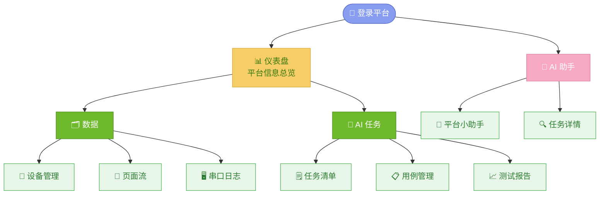
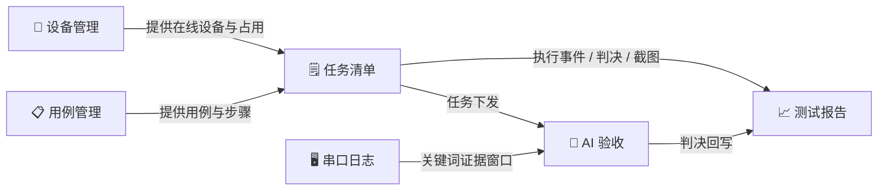
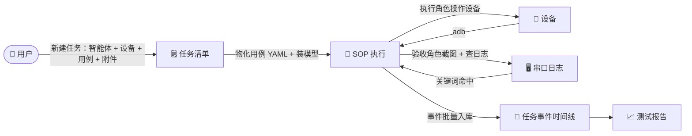

# 需求大纲 — Android-AutoTests

> 版本：v3.7 · 日期：2026-10-21 · 基线：`Kahoku` 主干实测（9 个 App / 19 张表 / 65 条业务路径 / 8 个前端模块 / 92 份能力规格）
> 本文档是平台的**需求总纲**，聚焦功能定位、用户场景、模块职责边界和交互流程。功能细节与验收标准以 `openspec/specs/` 为准，技术实现见 `ARCH-平台架构设计.md`。

---

## 一、项目定位

### 1.1 一句话定位

> 为 **测试工程师** 设计的 **AI 测试平台**：把用例写成文档，把任务交给 AI 双角色（执行 + 验收）跑完，结果回到可回看的任务事件时间线与测试报告。

### 1.2 功能介绍

1. 输入 需求文档 让 Agent 阅读需求文档输出 功能测试点 与 UI自动化测试步骤

2. 让 Agent 具备执行能力，可以控制手机、电脑与接送设备串口日志，模拟 "人" 的行动去执行测试任务

### 1.3 产品边界

**✅ 本期范围**

1. Android 8.0+ UI 自动化；USB + WiFi ADB 接入。
2. JWT 认证（登录 / 注册 / 刷新 / 登出 / 当前身份），复用 Django 内置用户表。
3. 文档式用例：项目、目录、文件、用例、步骤五层；支持移动、批量删除、导入导出。
4. AI 任务：按智能体下发、指定设备与用例、重跑、取消；同一设备串行、不同设备并行。
5. AI 执行内核：AgentScope SOP 双角色（`executor` + `verifier`），模型支持 DeepSeek 与阿里百炼。
6. 验收证据：设备截图 + 串口日志关键词命中（动作后 5 秒窗口，动作前 30 秒基线）。
7. 观测：四组运行日志、任务事件时间线、测试报告、仪表盘趋势与模型费用。

**❌ 非本期**

1. iOS 设备；Web / API 自动化（相关能力已退役）。
2. 设备云租用、跨团队多租户隔离。
3. OAuth / SSO 等第三方身份源。
4. AI 自主修复失败用例、自主生成完整用例集。
5. 分布式执行集群、跨机调度。

---

## 二、目标用户

### 2.1 用户画像

| 角色 | 核心诉求 | 使用频率 |
|------|---------|:--:|
| **测试工程师**（主要） | 快速建用例、一键跑回归、失败能定位到具体步骤与证据 | 每日 |
| **QA 负责人**（次要） | 任务执行结果、通过率趋势、设备占用情况、AI 花费 | 每周 |
| **产品经理**（次要） | 一键跑冒烟用例、看报告结论 | 每周 |

### 2.2 用户核心旅程

```
登录 → 仪表盘总览 → 设备管理接入/占用设备 → 用例管理建用例
   → AI 助手下发任务（选智能体 / 设备 / 用例 / 附件）
   → 任务详情看事件时间线与判决 → 测试报告看汇总 → 串口日志复核证据
```

---

## 三、平台业务场景

### 3.1 登录功能总览



### 3.2 数据业务流



### 3.3 AI 助手业务流



> 任务执行由后端引擎完成（无独立前端页面）；前端通过任务详情与报告页回看。

---

## 四、子模块功能规格索引


## 五、非功能约束

| 类别 | 约束 |
|------|------|
| 并发 | 单机；同一设备同一时刻至多一条执行任务，不同设备可并行 |
| 实时性 | 无 WebSocket / SSE；任务进度与列表靠 HTTP 轮询 |
| 安全 | 全部 `/api/` 走 JWT；公开面仅登录/注册/刷新、Admin、静态资源、API 文档；AI 智能体写操作仅超管 |
| 契约 | 响应信封 `{status, data}`；错误 `{status, message}` + HTTP 状态码；JSON snake_case；`/api/` 尾斜杠 |
| 数据 | 表前缀 `ai_ cm_ dp_ rg_ sl_ task_ wf_`；SQLite（开发）/ MySQL（生产）；Redis 承载 JWT 吊销与 Channels layer |
| 可观测 | 后端 / 智能体 / 设备 / 串口四组日志；任务事件与费用可回看 |
| 质量 | 本地 `python run.py check` 与 CI 同一批门禁（23 项）；后端测试以 pytest 分层维护；接口契约基线由 drf-spectacular 生成并纳入门禁 |

---

## 六、术语

| 术语 | 含义 |
|------|------|
| SOP | AgentScope 的步骤化执行单元：每步含「执行描述 + 验收标准」 |
| executor / verifier | AI 执行角色 / AI 验收角色，一次运行内成对出现 |
| 任务 | 一次下发（智能体 + 设备 + 用例 + 附件），落 `task_tasks` |
| 用例 / 步骤 | 文档式测试资产，步骤只含「操作 / 预期」两段文本 |
| 证据窗口 | 动作后 5 秒内截取串口日志命中；动作前 30 秒作基线 |
| 任务事件 | 模型调用、工具调用、内容块、判决等结构化记录，落 `task_events` |
