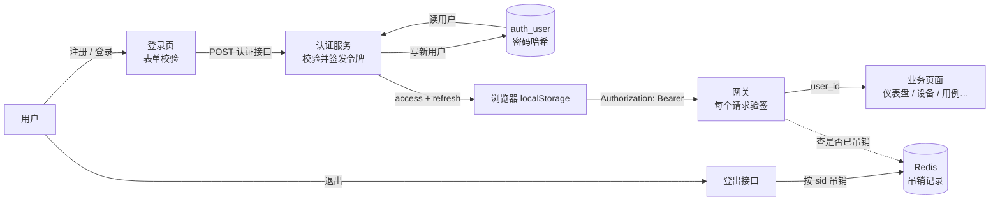
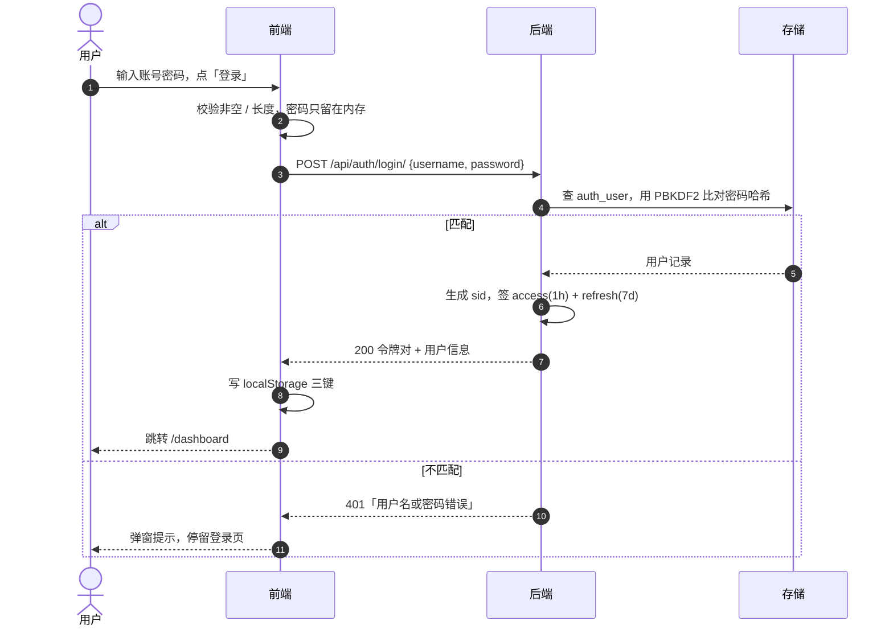

# 认证业务全景（精简版）

> 基线：`Kahoku` · 2026-10-26 · 读法：先看第 0 节结论与第 2 节大图；查代码用第 5 节文件表；对接/排查接口用第 6 节协议表。
> 详细实现（时序、行号、安全矩阵）见 [认证模块代码地图-20261026.md](认证模块代码地图-20261026.md)。

---

## 0. 结论（先看这 5 条）

1. **认证只有 5 个业务功能**：注册、登录、保持登录（自动续期）、登出、识别当前用户（含管理员标记）。
2. **一条主数据流**：密码 → 登录接口 → `auth_user` 比对哈希 → 签发 JWT → 浏览器保存 → 每次请求带 Bearer → 网关验签 → 业务页面。
3. **「能不能进平台」分三层判**：后端判密码对不对（401）；前端判有没有拿到 token 并写入本地（跳 `/dashboard`）；网关判每个请求的 token 是否有效（401 → 续期或回登录）。
4. **多账号 = 前端只留一个**：换号要先退出（守卫不允许带 token 回登录页），后登录覆盖前一个；后端不存会话表，靠 JWT 里的 `sid` 区分每次登录；登出只吊销当前 `sid`，同账号其它端不受影响。
5. **密码只以明文活一次请求**（HTTPS 传输），落库只有 PBKDF2 哈希；JWT 存 `localStorage`——简单、免疫 CSRF，但 XSS 可窃取，这是当前最大的安全取舍。

---

## 1. 认证有哪些业务功能

| 功能 | 用户动作 | 系统做什么 | 成功的标志 | 失败的样子 |
|------|----------|------------|------------|------------|
| **注册** | 在登录页切「注册」，填账号/邮箱/密码/确认密码 | 校验格式与两次密码 → 写 `auth_user`（密码哈希）→ 直接签发令牌 | 跳到 `/dashboard`，已是登录态 | 弹窗「用户名已存在」/字段提示 |
| **登录** | 填账号密码，点「登录」 | `authenticate()` 查用户并比对哈希 → 签发 access+refresh | 跳到 `/dashboard` | 弹窗「用户名或密码错误」，停留登录页 |
| **保持登录** | 无感（访问页面时） | access 过期返回 401 → 前端用 refresh 静默换新 access → 重试原请求 | 页面数据正常刷新，用户无感知 | refresh 也失效 → 清本地会话，回登录页 |
| **登出** | 点侧栏「退出」 | 调登出接口按 `sid` 吊销整组令牌（Redis）→ 清本地三键 | 回 `/login`，旧 access/refresh 都失效 | Redis 不可用 → 提示稍后重试，**仍保持登录** |
| **识别当前用户** | 打开依赖权限的页面 | 调 `/me` 拿 `is_superuser`，决定管理入口显隐 | 管理入口按身份显示 | 拉取失败一律按「非管理员」处理 |
| *支撑：记住账号* | 勾选「记住账号」 | 只把**用户名**存本地，下次自动填 | 下次打开登录页账号已填好 | —— |
| *支撑：未登录拦截* | 直接访问业务页 | 前端路由守卫检查本地有没有 token | 有 token 放行 | 无 token 跳 `/login` |

**本期没有**：改密、忘记密码、邮箱验证、验证码、MFA、登录审计、账号列表切换。这些不属于现有认证范围。

---

## 2. 业务数据流总图



读图要点：

- **实线是主路径**：登录成功后，浏览器拿到的不是「会话 ID」，而是两张自包含的 JWT；之后每次请求都靠它证明身份。
- **虚线的 Redis 只在两处出现**：登出写吊销、网关查吊销。数据库不存会话。
- 注册和登录**共用同一条出口**：都返回一对令牌，所以注册成功也直接进平台。

---

## 3. 一次登录，数据怎么走



### 3.1 从点击到进入平台，经过 4 道关

| # | 判定点 | 谁判 | 判据 | 不通过时 |
|---|--------|------|------|----------|
| 1 | 表单是否合格 | 前端 | 账号非空、长度；密码非空 | 不请求，字段下提示 |
| 2 | 密码是否正确 | 后端 | `auth_user` 存在 + 哈希匹配 | 401，前端弹窗 |
| 3 | 是否允许进页面 | 前端 | 响应 `status=true` 且拿到 refresh → 写本地 → `router.push` | 停留登录页 |
| 4 | 是否允许取数据 | 网关 | 每个 `/api/*` 的 Bearer 验签 + 吊销检查 | 401 → 自动续期；续期失败回登录 |

> 注意第 3 道是「乐观放行」：路由守卫只看**本地有没有 token**，不判断是否过期。过期 token 也会先进页面外壳，等第一个接口 401 再续期或踢回登录。这是「先给界面、再验身份」的取舍。

---

## 4. 多账号与会话管理

**核心事实**：前端没有「账号列表」，后端没有「会话表」。一次登录 = 一个 `sid`，藏在两张 JWT 里。

| 场景 | 实际行为 |
|------|----------|
| 同一浏览器换号 | 必须先从侧栏「退出」（守卫不允许带 token 回登录页）。退出会吊销 A 的 `sid`，再登录 B 时三个本地键被**覆盖**。只清本地不退出的话，A 的令牌在服务端仍有效到过期。 |
| 同账号多端登录 | 每次登录生成新 `sid`，各自独立；A 端登出只吊销 A 的 `sid`，B 端照常使用。没有「最多 N 台」限制。 |
| 同浏览器多标签 | 共享同一份 `localStorage`，等同同一账号；一个标签登出后，其他标签下一次请求 401，续期失败即回登录页。 |
| 账号切换 / 并存 | 不支持。规格明确「单账号会话」，没有添加账号入口，也没有账号列表。 |
| 登出影响范围 | 仅当前 `sid`：该次登录的 access + refresh 一起失效，其它登录不受影响。 |
| 忘记退出就关浏览器 | 令牌留到过期（access 1h、refresh 7d）；期间重新打开仍是登录态。 |

**为什么能这样设计**：JWT 自包含（`sub` 用户、`sid` 会话、`jti` 单令牌、`exp` 过期），服务端无需保存会话；吊销靠 Redis 黑名单，所以「登出」不是删会话，而是写一条有时效的作废记录。

---

## 5. 模块（文件）地图

> 约定：一个文件 = 一个模块；「何时看它」用于定位问题或迭代时快速找入口。

### 5.1 前端

| 文件 | 负责的功能 | 何时看它 |
|------|------------|----------|
| `frontend/src/views/LoginView.vue` | 登录页外壳：登录/注册双态切换、挂错误弹窗 | 改页面布局、加入口 |
| `frontend/src/views/components/LoginCard.vue` | 登录表单：账号、密码、记住账号、提交 | 改登录输入项/按钮 |
| `frontend/src/views/components/RegisterCard.vue` | 注册表单：账号、邮箱、密码、确认密码 | 改注册输入项/校验提示位置 |
| `frontend/src/views/components/LoginErrorOverlay.vue` | 服务端错误弹窗 | 改错误提示样式 |
| `frontend/src/views/LoginView.logic.ts` | 页面编排：收集字段、调校验、决定提交 | 改登录页交互顺序 |
| `frontend/src/views/composables/useAuthFlow.ts` | 认证主流程：调接口 → 存会话 → 跳转 / 显示错误 | 排查「登录了没跳转」 |
| `frontend/src/views/composables/useViewStateMachine.ts` | 登录 / 注册二态切换 | 加第三种认证方式时 |
| `frontend/src/views/composables/useSavedUsername.ts` | 「记住账号」读写本地用户名 | 改记住账号行为 |
| `frontend/src/shared/composables/useLoginForm.ts` | 前端字段校验规则与文案 | 改密码长度/提示 |
| `frontend/src/shared/api/auth.ts` | 认证接口唯一出口：登录/注册/登出/当前用户 | 改请求参数或接口地址 |
| `frontend/src/shared/auth/token-storage.ts` | 本地会话三键的读写与清空 | 排查 token 丢失、换号残留 |
| `frontend/src/shared/api-client.ts` | axios 实例：`/api` 前缀、超时、挂拦截器 | 改基础地址/超时 |
| `frontend/src/shared/api-auth-interceptors.ts` | 自动带 Bearer；401 自动续期并重试；续期失败踢回登录 | 排查「401 没续期 / 续期死循环」 |
| `frontend/src/router.ts` | 路由守卫：无 token 回登录，有 token 不回登录页 | 改未登录拦截规则 |
| `frontend/src/shared/components/AppSidebar.vue` | 退出登录入口与调用顺序 | 改登出交互 |
| `frontend/src/shared/composables/useAuthUser.ts` | 拉 `/me`，得到是否管理员，供页面显隐入口 | 加管理员专属功能 |
| `frontend/src/shared/types/auth.ts` | 认证 DTO（令牌、视图状态、字段错误） | 接口字段变更时 |
| `frontend/src/shared/types/api-error.ts` | 错误文案归一（401/409/网络） | 改错误提示 |

### 5.2 后端

| 文件 | 负责的功能 | 何时看它 |
|------|------------|----------|
| `backend/config/urls.py` | 把 `/api/auth/` 挂到 accounts | 改前缀 |
| `backend/apps/accounts/urls.py` | 5 条认证路径 | 加/删端点 |
| `backend/apps/accounts/views.py` | 5 个端点编排：登录、注册、续期、登出、当前用户 | 改状态码/业务分支 |
| `backend/apps/accounts/serializers.py` | 入参校验 + 登录时调 `authenticate()` | 改校验规则/错误文案 |
| `backend/apps/accounts/api.py` | 唯一写口：创建用户（唯一约束 → 409） | 改注册落库 |
| `backend/shared/auth/jwt_auth.py` | JWT 签发 / 验签 / `jti`+`sid` 吊销 / Redis 交互 | 改 TTL、claims、吊销逻辑 |
| `backend/gateway/middleware.py` | 全局网关：公开路径放行、其余验 access、注入 `user_id` | 改免登录白名单 |
| `backend/shared/auth/drf_auth.py` | DRF 认证类：验 token 后查出 `User` | 排查 DRF 接口 401 |
| `backend/shared/renderers.py` | 统一响应信封 `{status,data}` / `{status,message}` | 改响应格式 |
| `backend/config/settings.py` | TTL、DRF 认证类/渲染器、中间件顺序、CORS/HTTPS | 改安全配置 |

---

## 6. 接口协议

### 6.1 通用约定

| 项 | 约定 |
|----|------|
| 基址 | 前端 `baseURL=/api`；开发经 Vite 代理到 `:8766`，生产由同源反向代理转发 |
| 方法/格式 | `POST` 用 JSON；字段 **snake_case**；路径**必须带尾斜杠**（缺了是 404） |
| 成功信封 | `{ "status": true, "data": {...} }` |
| 失败信封 | `{ "status": false, "message": "给用户看的中文" }` + HTTP 状态码 |
| 身份头 | `Authorization: Bearer <access_token>` |
| 浏览器凭证 | 不使用 Cookie（JWT 链），因此无需 CSRF token |

**调用链**：浏览器 axios（`baseURL=/api`）→ 开发代理 `:5173` / 生产同源反代 → Django 网关 → `/api/auth/*` 视图。前端只认 HTTP，不直连数据库或 Redis。

### 6.2 五个端点：谁调谁、传什么、回什么

| 端点 | 调用方 → 被调方 | 请求数据 | 成功响应（`data` 内） | 失败 |
|------|------------------|----------|------------------------|------|
| `POST /api/auth/login/` | 前端登录页 → 认证服务 | `{username, password}` | `{access_token, refresh_token, token_type:"bearer", user:{id, username}}` | 400 缺字段 / 401 凭证错 |
| `POST /api/auth/register/` | 前端注册表单 → 认证服务 | `{username, password, password2, email}` | 同登录，`user` 多一个 `email` | 400 校验 / 409 用户名已存在 |
| `POST /api/auth/refresh/` | 前端拦截器 → 认证服务 | `{refresh_token}` | `{access_token, token_type:"bearer"}` | 401 令牌无效/过期/已吊销 |
| `POST /api/auth/logout/` | 侧栏「退出」→ 认证服务 | 无请求体，仅 Bearer 头 | `{}` | 401 无/坏令牌；503 + `retry:true`（Redis 不可用） |
| `GET /api/auth/me/` | 权限相关页面 → 认证服务 | 无，仅 Bearer 头 | `{user:{id, username, is_superuser}}` | 401 无/坏令牌；404 用户已删 |

### 6.3 登录请求 / 响应示例

```json
// 请求：POST /api/auth/login/
{ "username": "alice", "password": "******" }

// 成功：200
{
  "status": true,
  "data": {
    "access_token": "eyJ...",
    "refresh_token": "eyJ...",
    "token_type": "bearer",
    "user": { "id": 7, "username": "alice" }
  }
}

// 失败：401
{ "status": false, "message": "用户名或密码错误" }
```

### 6.4 已登录请求长什么样

```http
GET /api/devices/ HTTP/1.1
Authorization: Bearer eyJ...
```

网关做三件事：验签 → 查 `jti`/`sid` 是否被吊销 → 把 `sub`（用户 id）注入 `request.user_id`。任何一步失败都是 401。

---

## 7. 边界情况速查

| 情况 | 结果 |
|------|------|
| access 过期（1h） | 业务请求 401 → 自动用 refresh 换新 access → 重试原请求，用户无感 |
| refresh 过期（7d）或已登出 | 续期 401 → 清本地 → 回 `/login` |
| 登出时 Redis 挂了 | 后端 503，前端提示并**保留登录态**（宁可登不出，也不假成功） |
| 验签时查吊销的 Redis 挂了 | 放行（可用性优先），代价是已吊销令牌短时可用 |
| 重复用户名 | 409「用户名已存在」（数据库唯一约束保证，非先查后写） |
| 用户被删除后仍持旧 access | 页面外壳可进；DRF 接口查不到用户 → 401 |
| 已登录访问 `/login` | 守卫送回 `/dashboard` |

---

## 8. 安全边界（只留结论）

| 已做 | 缺口 |
|------|------|
| PBKDF2 加盐哈希，密码不回显、不落前端、不写日志 | 无登录限流/锁定，6 位密码可被在线爆破 |
| 登录失败统一文案，防账号枚举 | JWT 在 `localStorage` 且无 CSP，XSS 可窃取 7 天 refresh |
| 登出按 `sid` 作废整组令牌，Redis 挂了拒绝登出 | 无改密/找回/邮箱验证；密码策略只有「≥6 位」 |
| Bearer 头 + 显式 CSRF 豁免；生产 CORS 白名单 | 默认 HTTP（`SECURE_SSL_REDIRECT=False`），部署未强制 HTTPS 时明文可读 |
| 前后端校验文案/阈值有对拍测试 | 无认证审计（`last_login` 也不更新） |

---

## 9. 迭代时先改哪里

| 需求 | 入口 |
|------|------|
| 加一种登录方式（如手机号） | `serializers.py` + `views.py` → `shared/api/auth.ts` → `LoginCard.vue` |
| 调令牌时长 | `settings.py` 的 `JWT_ACCESS_TTL` / `JWT_REFRESH_TTL` |
| 改密码规则 | `serializers.py` 与 `useLoginForm.ts` **两边一起改**（有对拍测试） |
| 加管理员专属功能 | 前端 `useAuthUser`，后端 `require_superuser` / DRF 权限类 |
| 加免登录路径 | `gateway/middleware.py` 的 `PUBLIC_PREFIXES`（同步前端拦截器排除清单） |
| 换令牌存储方式 | `token-storage.ts` + `api-client.ts` + 后端下发方式（跨前后端变更，建议走 OpenSpec） |

---

*配套：完整时序、逐行定位、安全矩阵见 [认证模块代码地图-20261026.md](认证模块代码地图-20261026.md)。*
