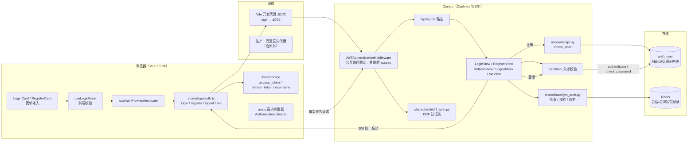
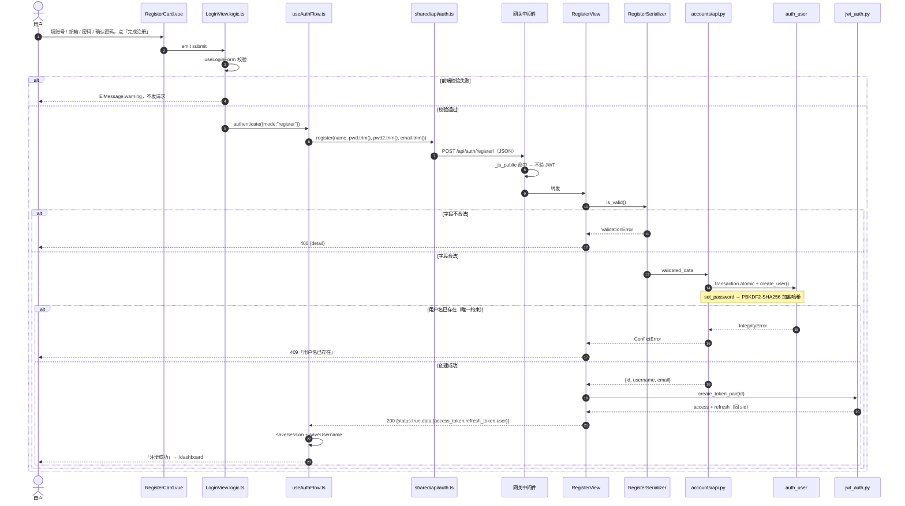
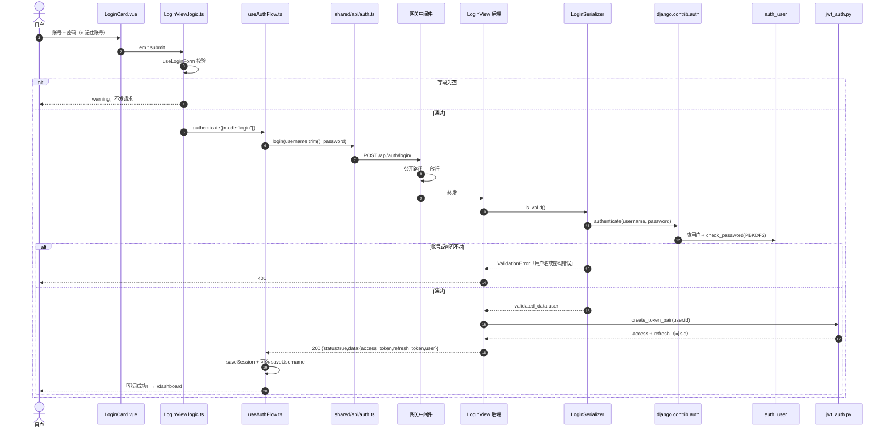
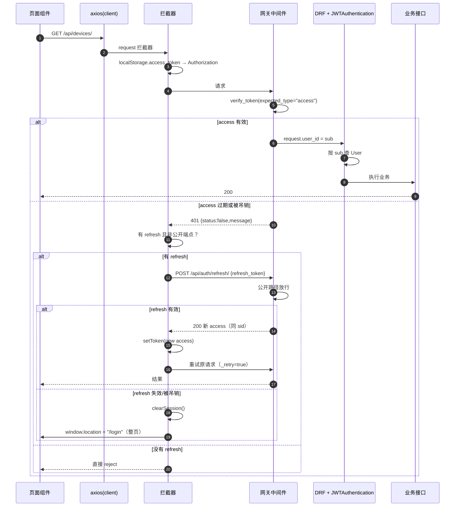
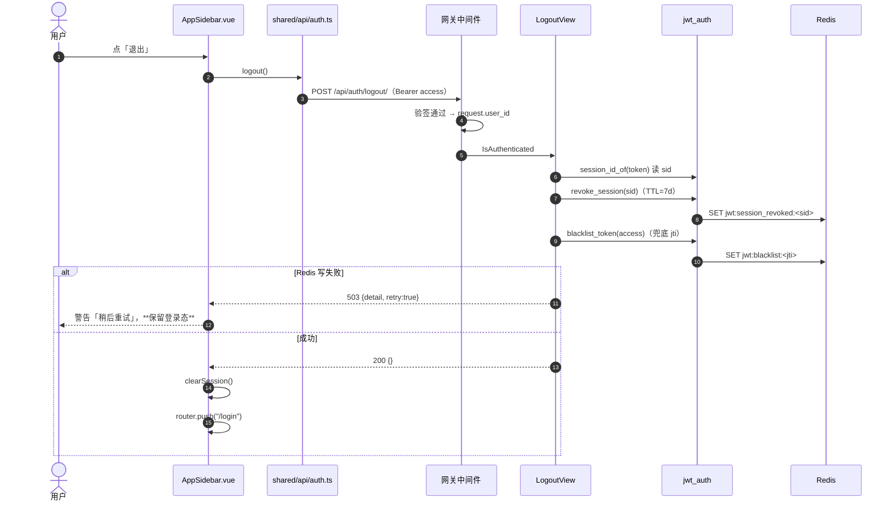

# 认证模块代码地图 — 注册 / 登录 / 续期 / 登出 / 安全

> 如果只想看业务全貌与文件职责，先读精简版 [认证业务全景-20261026.md](认证业务全景-20261026.md)；本文是它的逐行实现附录。

> 基线：`Kahoku` 主干 · 统计日期：2026-10-26
> 范围：`frontend/src/views/**`、`frontend/src/shared/{auth,api,composables}/**`、`backend/apps/accounts/**`、`backend/{gateway,shared}/**`、相关配置
> 规格真相源：`openspec/specs/auth-session`、`auth-form-validation`、`auth-registration`、`auth-response-shape`、`api-path-convention`

---

## 0. 一页答案

1. **没有独立的 `/register` 页面**。注册从 `/login` 页主视觉区的「注册 →」按钮开始，在同一个页面内把左侧表单换成注册表单。
2. **账号密码只走一条路**：浏览器表单 → `POST /api/auth/login/` 或 `/api/auth/register/` 的 JSON 请求体 → Django 视图 → Serializer → `authenticate()` / `create_user()`。**密码明文不落 localStorage、不进 URL、不回显、不写响应、不写日志**。
3. **服务端只存哈希**：`auth_user.password`，Django 默认 `PBKDF2PasswordHasher`（本项目未覆盖 `PASSWORD_HASHERS`）。
4. **登录成功后签发一对 JWT（HS256）**：`access`（1h）+ `refresh`（7d），两者共享 `sid`；前端把 **access / refresh / username 三个键写进 `localStorage`**。
5. **之后每个 `/api/*` 请求**由 axios 拦截器自动加 `Authorization: Bearer <access>`；Django 网关中间件验签 → 注入 `request.user_id`；DRF 认证类再按 `sub` 查出 `User`。
6. **access 过期时**：业务请求收到 401 → 前端用 refresh 换新 access（同一 `sid`）→ 重试原请求；刷新失败则清空本地会话并整页跳 `/login`。
7. **登出 = 按 `sid` 作废整个会话**：Redis 写 `jwt:session_revoked:<sid>`（TTL 7 天），access 与 refresh 一起失效；Redis 不可用时**拒绝登出**（503 + `retry`），不假装成功。
8. **管理员是另一条链**：`/admin/` 走 Django session + CSRF，与 JWT 链互不影响；普通用户只能通过注册页自助创建，注册接口**不能**产生 `is_superuser`。

---

## 1. 全景图



**一句话读法**：密码明文只在一次登录/注册请求内被使用（Serializer 交给 `authenticate()` 或 `create_user()`），之后系统只认 JWT。JWT 的「身份证」在 localStorage，JWT 的「挂失记录」在 Redis。

---

## 2. 文件地图

### 2.1 前端

| 文件 | 职责 | 关键位置 |
|------|------|----------|
| `frontend/src/views/LoginView.vue` | 登录页唯一入口；登录/注册双态切换；挂错误弹窗 | `:129-150` 模式按钮、`:165-194` 两张表单 |
| `frontend/src/views/LoginView.logic.ts` | 表单状态编排：收集字段、调校验、提交 | `:70-81` 切换清表单、`:84-95` 登录、`:97-114` 注册 |
| `frontend/src/views/composables/useAuthFlow.ts` | 认证流程：调 API → 存会话 → 跳转；统一服务端错误 | `:43-80` |
| `frontend/src/views/composables/useViewStateMachine.ts` | `login` / `register` 二态机 | `:16-23` |
| `frontend/src/views/composables/useSavedUsername.ts` | 「记住账号」：只存用户名 | `:12-23` |
| `frontend/src/views/components/LoginCard.vue` | 登录表单（账号/密码/记住账号） | `:34-73` |
| `frontend/src/views/components/RegisterCard.vue` | 注册表单（账号/邮箱/密码/确认密码） | `:35-93` |
| `frontend/src/views/components/LoginErrorOverlay.vue` | 服务端错误弹窗（L5 覆盖层） | 全文 |
| `frontend/src/shared/composables/useLoginForm.ts` | 前端字段校验与阈值（与后端对拍） | `:23-36` 登录、`:40-72` 注册 |
| `frontend/src/shared/api/auth.ts` | 认证 HTTP 唯一出口 | `:5-8` 登录、`:10-23` 注册、`:26-29` 登出、`:38-40` 当前用户 |
| `frontend/src/shared/auth/token-storage.ts` | 本地会话读写（localStorage） | `:20-30` 读、`:35-40` 写、`:43-45` 只换 access、`:48-52` 清空 |
| `frontend/src/shared/api-client.ts` | axios 实例（`baseURL=/api`）+ 挂拦截器 | `:23-38` |
| `frontend/src/shared/api-auth-interceptors.ts` | 自动带 token；401 单飞续期并重试 | `:34` 公开路径、`:54-60` 带 token、`:62-95` 续期 |
| `frontend/src/shared/composables/useAuthUser.ts` | 拉一次 `/me`，决定管理入口显隐 | `:11-29` |
| `frontend/src/router.ts` | 路由守卫：有无 token 的双向重定向 | `:40-49` |
| `frontend/src/shared/components/AppSidebar.vue` | 退出登录：先调服务端，再清本地 | `:30-44` |
| `frontend/src/shared/types/auth.ts` | 认证 DTO | 全文 |
| `frontend/src/shared/types/api-error.ts` | 错误文案净化（含 401/409/网络） | `:20-48` |

### 2.2 后端

| 文件 | 职责 | 关键位置 |
|------|------|----------|
| `backend/config/urls.py` | 把 `/api/auth/` 挂到 accounts | `:31` |
| `backend/apps/accounts/urls.py` | 5 条路径，全部带尾斜杠 | `:11-17` |
| `backend/apps/accounts/views.py` | 登录 / 注册 / 续期 / 登出 / 当前用户 | `:35-64`、`:67-104`、`:107-142`、`:145-170`、`:173-200` |
| `backend/apps/accounts/serializers.py` | 入参校验；登录时调用 `authenticate()` | `:14-43`、`:46-81` |
| `backend/apps/accounts/api.py` | 唯一写口：`create_user`（savepoint + 唯一约束） | `:19-35` |
| `backend/shared/auth/jwt_auth.py` | JWT 签发、验签、`jti`/`sid` 吊销 | `:157-178`、`:181-208`、`:211-236`、`:245-258`、`:278-294` |
| `backend/gateway/middleware.py` | 全局 JWT 网关；公开路径白名单；CSRF 豁免标记 | `:21-46`、`:54-102` |
| `backend/shared/auth/drf_auth.py` | DRF 认证类：验 token → 查 `User` | `:36-62` |
| `backend/shared/auth/require_auth.py` | 裸 Django view 的防御性装饰器 | `:14-37`、`:40-74` |
| `backend/shared/renderers.py` | 统一响应信封 `{status,data}` / `{status,message}` | `:23-35` |
| `backend/config/settings.py` | SECRET_KEY、JWT TTL、DRF 认证/渲染器、中间件顺序、CORS/HTTPS | `:27-45`、`:90-104`、`:262-264`、`:309-323` |

### 2.3 运行时与代理

| 位置 | 事实 |
|------|------|
| `run.py:31`、`:40-41` | `redis` → `backend:8766` → `frontend:5173` 启动顺序 |
| `frontend/vite.config.js` 的 `server.proxy` | 开发期 `/api` 与 `/media` 代理到 `localhost:8766`；`/admin` **不代理**，需直接访问 8766 |
| `backend/config/settings.py:108-111` | `APPEND_SLASH=False`：`POST /api/auth/login`（无尾斜杠）是 **404**，不是 301 |

### 2.4 测试守护（改认证前后必看）

| 层 | 文件 |
|----|------|
| 前端单测 | `frontend/tests/login/p0/*`（8 个：token-storage、useAuthFlow、useLoginForm、拦截器、卡片…）、`p1/*`（3 个） |
| 后端接口 | `tests/api/test_login_page.py`、`test_auth_session_flow.py`、`test_auth_tokens.py`、`test_auth_register_concurrency.py` |
| 契约对拍 | `tests/graybox/unit/test_auth_validation_parity.py`（前后端文案/阈值）、`test_auth_frontend_contract.py`、`test_auth_endpoint_declaration.py`、`test_logout_session_revocation.py` |
| 端到端 | `tests/e2e/test_login_e2e.py`（零密钥：用公开注册接口自建 `e2e_probe`） |

---

## 3. 注册全过程

### 3.1 从哪里开始

- **入口**：`/login` 页主视觉区的「注册 →」（`LoginView.vue:140-149`）→ `switchMode("register")` → 表单换成 `RegisterCard`。
- **没有独立路由**：`router.ts` 只注册 `/login`，不存在 `/register`。
- **后端入口**：`POST /api/auth/register/`（`accounts/urls.py:13`）。
- **初始化**：切到注册时会清空四个字段（`LoginView.logic.ts:70-76`），并清掉当前错误提示。

### 3.2 时序



### 3.3 逐步拆解

| # | 步骤 | 代码事实 |
|---|------|----------|
| 1 | 模式切换 | `LoginView.vue:140-149` → `switchMode("register")`；`useViewStateMachine.ts:16-23` 只管状态，不发请求 |
| 2 | 表单收集 | `RegisterCard.vue:35-93`：账号、邮箱、密码、确认密码；`autocomplete` 分别为 `username` / `email` / `new-password` |
| 3 | 前端校验 | `useLoginForm.ts:40-72`：账号 3–20、邮箱含 `@`、密码 ≥6、两次一致；错误内联展示 |
| 4 | 提交前拦截 | `LoginView.logic.ts:97-114`：不通过只弹 warning，**不产生任何 HTTP 请求** |
| 5 | 组装请求 | `useAuthFlow.ts:59-65`：账号 trim；密码与确认密码 **trim** 后发送；邮箱 trim |
| 6 | 发出请求 | `shared/api/auth.ts:10-23` → axios `baseURL=/api` → 实际 URL `/api/auth/register/`；JSON body 含 `username/password/password2/email` |
| 7 | 开发代理 | 浏览器 :5173 → Vite 代理 → Django :8766；生产由同源反向代理转发（仓库外） |
| 8 | 网关放行 | `middleware.py:21-33` 的 `PUBLIC_PREFIXES` 含 `/api/auth/register`；`:71-72` 直接放行，不验 JWT |
| 9 | 视图校验 | `views.py:67-104` → `RegisterSerializer`；任一字段失败 → 400（`_first_error` 取第一条） |
| 10 | 写库 | `api.py:19-35`：`transaction.atomic()` 包住 `User.objects.create_user()`；`create_user` 内部 `set_password` 生成 PBKDF2 哈希；捕获 `IntegrityError` → `ConflictError` → **409** |
| 11 | 签发令牌 | `views.py:94` → `jwt_auth.create_token_pair()`：生成 `sid`，access/refresh 都带同一 `sid` |
| 12 | 响应 | `renderers.py:23-35` 包装为 `{status:true,data:{...}}`；返回 `user: {id, username, email}` |
| 13 | 本地落盘 | `useAuthFlow.ts:66-68` → `token-storage.saveSession()` 写 3 个键；「记住账号」开则额外写 `saved_username` |
| 14 | 跳转 | `useAuthFlow.ts:71`：`router.push("/dashboard")`，注册即登录，不停留登录页 |

### 3.4 注册写进 `auth_user` 的那一行

`accounts` 没有 `models.py`，直接使用 Django 内置用户表；注册成功后新增一行：

| 字段 | 值 |
|------|-----|
| `username` | 前端提交值（去首尾空白），数据库唯一 |
| `password` | `pbkdf2_sha256$<迭代次数>$<盐>$<哈希>`，不可逆 |
| `email` | 前端提交值（仅校验含 `@`，不唯一、不验证） |
| `is_superuser` / `is_staff` | `False`（注册接口不写这两个字段） |
| `is_active` | `True`（`create_user` 默认） |
| `last_login` | 保持 `NULL` —— 登录走 JWT，没有调用 `django.contrib.auth.login()`，后台看不到「最后登录时间」 |

### 3.5 注册失败分支

| 场景 | 后端 | 前端表现 |
|------|------|----------|
| 账号 <3 / >20、密码 <6、两次不一致、邮箱无 `@` | 400 `{detail}` | 错误弹窗显示后端第一条文案 |
| 账号或密码为空 | 400 | 同上 |
| 用户名已存在 | 409「用户名已存在」 | 同上（`formatApiError` 优先取 `message`） |
| 网络断开 / 后端未启动 | 无响应 | 「网络连接失败，请稍后重试」 |
| 生产环境 `DJANGO_SECRET_KEY` 未配置 | 服务起不来（启动即 `RuntimeError`） | 登录页整体不可用 |

> 唯一性**不在** Serializer 里判重（`serializers.py:77-78` 注释），只靠数据库唯一约束 + savepoint，避免并发下「校验通过、写库炸 500」。

---

## 4. 登录全过程

### 4.1 时序



### 4.2 逐步拆解

| # | 步骤 | 代码事实 |
|---|------|----------|
| 1 | 打开登录页 | 路由 `/login`（`router.ts:13`）；默认 `viewState="login"`（`useViewStateMachine.ts:17`）；已登录访问会被守卫送回 `/dashboard`（`router.ts:46-48`） |
| 2 | 输入 | `LoginCard.vue:36-64`：账号 `autocomplete="username"`，密码 `type="password" show-password`（可点眼睛显形），`autocomplete="current-password"` |
| 3 | 「记住账号」 | `useSavedUsername.ts:13-23`：勾选则登录成功后把**用户名**写 `localStorage.saved_username`；不勾选则删除该键。**密码从不保存** |
| 4 | 前端校验 | `useLoginForm.ts:23-36`：用户名非空、非空白、≤150；密码非空（不校验长度） |
| 5 | 提交 | `LoginView.logic.ts:84-95` → `authenticate()`；账号 `trim()`，密码**原样**发送（`useAuthFlow.ts:59-65`）。服务端 DRF `CharField` 默认 `trim_whitespace=True`，比对前仍会去掉首尾空白 |
| 6 | 请求 | `POST /api/auth/login/`，JSON：`{username, password}`；axios 默认超时 120s（`api-client.ts:26`） |
| 7 | 网关 | `/api/auth/login` 在公开前缀内，**跳过 JWT 校验**；`_dont_enforce_csrf_checks` 不会设置，但 DRF `APIView` 本身 CSRF-exempt，因此无需 CSRF token |
| 8 | Serializer | `serializers.py:23-43`：字段缺失/空白 → 400；`authenticate(username=..., password=...)`；失败统一抛「用户名或密码错误」→ 视图映射 **401**（`views.py:47-55`） |
| 9 | 密码校验 | Django `ModelBackend.authenticate()` → `User.check_password()` → 读取 `auth_user.password` 的 PBKDF2 串比对；`is_active=False` 的用户在此被拒 |
| 10 | 签发 | `views.py:58` → `create_token_pair(str(user.id))`：`sub`=用户 id、`jti`=随机 UUID、`iat/exp`、`type`、`sid`（`jwt_auth.py:157-208`） |
| 11 | 响应 | `{status:true,data:{access_token, refresh_token, token_type:"bearer", user:{id,username}}}`（`views.py:59-64`），由 `EnvelopeJSONRenderer` 包信封 |
| 12 | 存储 | `saveSession()` 写 `access_token` / `refresh_token` / `username`；清掉遗留键 `auth_accounts`（`token-storage.ts:35-40`） |
| 13 | 跳转 | `router.push("/dashboard")`；页面卸载后表单内存中的密码由 GC 回收（应用**不会**主动清 `loginPassword`，但组件已销毁） |
| 14 | 失败提示 | `useAuthFlow.ts:72-78` 捕获错误 → `getApiErrorMessage` → `serverError` → `LoginErrorOverlay` 弹窗 |

### 4.3 登录失败分支

| 场景 | 后端 | 前端表现 |
|------|------|----------|
| 密码错 / 用户不存在 | 401「用户名或密码错误」 | 同一个错误弹窗（不区分，防账号枚举） |
| 用户名或密码为空 | 400「请输入用户名/密码」 | 前端通常已拦住，后端仍兜底 |
| 用户名超 150 或全空白 | 400 | 文案同上 |
| 网络/后端未启动 | — | 「网络连接失败」 |
| access 过期后再访问业务页 | 401 `{status:false,message}` | 拦截器静默续期；续期失败才跳登录页 |

> 登录错误**不触发**刷新：`PUBLIC_AUTH_PATHS` 显式排除 `/auth/login`、`/auth/register`、`/auth/refresh`（`api-auth-interceptors.ts:34-40`），否则一次密码错误会先把本地会话换掉。

---

## 5. 账号密码到底去了哪（凭据落点表）

### 5.1 落点

| 数据 | 产生时机 | 存放位置 | 谁能读到 | 生命周期 |
|------|----------|----------|----------|----------|
| **密码明文** | 用户输入 | ① Vue `ref`（内存）② JSON 请求体 ③ Django `request.data` → Serializer | 浏览器、链路（HTTPS 下加密）、服务端进程内存 | 请求结束即丢弃；**不落任何持久化介质** |
| **密码哈希** | 注册 | `auth_user.password`（`pbkdf2_sha256$...`，含随机盐） | 数据库管理员、Django 进程 | 永久；**当前没有改密接口**，只能后台 `set_password` |
| **access token** | 登录/注册/续期 | `localStorage.access_token`；每次请求的 `Authorization: Bearer` 头 | 同源 JS（含 XSS）、浏览器扩展、代理日志（若记录头） | 1 小时（`JWT_ACCESS_TTL=3600`） |
| **refresh token** | 登录/注册 | `localStorage.refresh_token`；只发给 `/api/auth/refresh/` | 同源 JS、浏览器扩展 | 7 天（`JWT_REFRESH_TTL=604800`），**不轮换** |
| **username** | 登录/注册 | `localStorage.username`；勾「记住账号」时另有 `saved_username` | 同源 JS、本机其他用户（同浏览器配置文件） | 登出清 `username`，`saved_username` 保留 |
| **email** | 注册 | `auth_user.email` | DB；接口只在注册响应里回显一次 | 永久；**不唯一、不验证** |
| **sid** | 签发令牌对 | 只存在于 access/refresh 的 JWT payload | 服务端、持有令牌者（可自行 base64 解码） | 随令牌；吊销记录 7 天 |
| **jti** | 每个令牌 | JWT payload | 同上 | 随令牌；吊销记录到 `exp`（最少 60s） |
| **会话吊销** | 登出 | Redis `jwt:session_revoked:<sid>` | 服务端 | 7 天（= refresh TTL） |
| **令牌吊销** | 登出（无 sid 的旧令牌兜底） | Redis `jwt:blacklist:<jti>` | 服务端 | 到令牌 `exp` |
| **is_superuser** | 建号时（`createsuperuser`） | `auth_user.is_superuser` | DB；`GET /api/auth/me` 返回 | 永久；前端只缓存于内存 |

### 5.2 密码**不会**出现在这些地方

- ❌ `localStorage` / `sessionStorage`：`token-storage.ts` 只写三个键（access、refresh、username），没有密码。
- ❌ URL / 查询串 / 路由参数：登录是 `POST` + JSON body。
- ❌ 接口响应：登录/注册响应只回 `user.id/username/email`，序列化器不会回显密码。
- ❌ 前端日志：`console.error` 只打错误 message；没有打印表单对象的语句。
- ❌ 后端日志：`LOGGING` 只有 console handler（`settings.py:447-473`），格式为 `level time name message`，**不记录请求体**；网关只在验签失败时记路径与原因（`middleware.py:92`）。
- ❌ 前端持久层：注册/登录成功后密码 `ref` 随组件销毁；没有写入 IndexedDB。

### 5.3 密码**会**出现在这些地方（需要接受的风险面）

- ✅ **浏览器 DevTools → Network**：请求体是明文 JSON（HTTPS 只保护传输，不保护本机调试者）。
- ✅ **浏览器密码管理器**：`autocomplete` 会提示保存（用户选择，不是应用行为）。
- ✅ **服务端进程内存**：`request.data` 与 `validated_data` 在请求生命周期内持有明文。
- ✅ **链路**：若部署为 HTTP（`SECURE_SSL_REDIRECT` 默认 `False`），中间网络可读明文——这是部署责任，不是代码默认安全。

---

## 6. 已登录请求与续期



关键实现：

| 机制 | 位置 | 说明 |
|------|------|------|
| 自动带 token | `api-auth-interceptors.ts:54-60` | 本地有 token 就加头；登录页通常无 token，因此登录/注册请求不带 |
| 单飞续期 | `:52`、`:74-80` | 并发 401 只发**一次** refresh，其余复用同一个 Promise |
| 只重试一次 | `:67`、`:72` | `_retry` 标记防死循环 |
| 公开端点排除 | `:34-40` | 登录/注册/刷新失败不清会话 |
| 续期失败处理 | `:89-93` | `clearToken()` + `window.location.href="/login"`（整页刷新，顺带清掉内存态） |
| 服务端续期 | `views.py:107-142` | 只换 access，**透传 sid**，不轮换 refresh |
| 双次验签 | `middleware.py:89` + `drf_auth.py:52` | 中间件验一次、DRF 再验一次（含两次 Redis `EXISTS`），功能正确但有重复开销 |

> 刷新页/新标签页时：路由守卫只看 `localStorage` 里**有没有** token（`router.ts:41-48`），不判断是否过期；真正的过期判断发生在第一个 API 请求的 401 上。

---

## 7. 登出全过程



要点：

- **登出按会话**，不按单令牌：同一 `sid` 的 access 与 refresh 一起失效；同一账号在别处的登录（不同 `sid`）不受影响（`openspec/specs/auth-session`）。
- **fail-closed**：Redis 不可用时返回 503 + `retry:true`，前端保留登录态（`AppSidebar.vue:33-41`）；宁可登不出去，也不假装成功。
- 网络中断/令牌已失效（非 503）时，前端仍清本地并回登录页（`:40-43`）。
- `jwt:blacklist:<jti>` 是历史兼容兜底：变更前签发的令牌没有 `sid`，只能按 `jti` 撤。

---

## 8. 当前用户与权限门

| 环节 | 事实 |
|------|------|
| 接口 | `GET /api/auth/me`（`views.py:173-200`），需 Bearer；返回 `{user:{id, username, is_superuser}}` |
| 前端 | `useAuthUser.ts:16-27`：首次调用拉一次，模块级缓存；失败一律当非超管 |
| 使用点 | `ai-assistant/index.vue:16-54`（「配置」入口）、`serial-log/index.vue:17-36`（监听开关 `can-manage`） |
| 后端强制 | 串口开关在视图内校验 `is_superuser`（`serial_log/views.py:49-50`）；AI 智能体写操作走 `permissions.py`；裸 view 用 `require_superuser`（`require_auth.py:40-74`） |
| 前端只是「显隐」 | 所有管理能力的最终裁决都在后端；前端隐藏不等于拒绝 |

> 注意：`useAuthUser` 的缓存**不会**在登出时重置。若在同一 SPA 生命周期内先登超管、再登普通账号，`isSuperuser` 可能仍是 `true`（管理入口错误显示，写操作仍会被后端 403）。属 UI 级缺陷，见第 10 节。

---

## 9. 管理员入口（另一条链）

| 项 | JWT 用户链 | Django Admin |
|---|---|---|
| 入口 | 前端 `/login`（:5173） | `http://<host>:8766/admin/`（Vite 不代理） |
| 凭据 | access/refresh JWT | `sessionid` Cookie |
| 校验 | 网关中间件 + DRF | Django `AuthenticationMiddleware` + `AdminSite` |
| CSRF | Bearer 头，中间件置 `_dont_enforce_csrf_checks` | 正常 CSRF 保护 |
| 权限 | `is_superuser` 判 UI + 接口 | `is_staff` + `is_superuser` |
| 密码 | 同一张 `auth_user`，同一哈希 | 同左 |

创建超管：`python manage.py createsuperuser`。注册接口没有 `is_superuser` 字段，**无法**自助提权。

---

## 10. 安全控制清单

### 10.1 已实现

| 控制 | 证据 | 说明 |
|------|------|------|
| 密码加盐哈希 | `api.py:32`（`create_user`）+ Django 默认 `PBKDF2PasswordHasher` | 实测 `django.conf.global_settings.PASSWORD_HASHERS[0]`；项目未覆盖 |
| 密码不回显 | `views.py:59-64`、`:95-103` | 响应只含 id/username/email |
| 登录错误统一 | `serializers.py:38-40` | 用户不存在与密码错同为「用户名或密码错误」，防账号枚举 |
| 唯一性靠 DB | `api.py:28-34` | `transaction.atomic()` savepoint + `IntegrityError` → 409，不泄漏 500 |
| JWT 不变量 | `jwt_auth.py:232-235` | 缺 `sub` 直接 401，避免下游 500 |
| 令牌类型校验 | `jwt_auth.py:224-231` | access 不能当 refresh 用，反之亦然 |
| 会话级吊销 | `jwt_auth.py:245-258` | 按 `sid` 一次撤 access+refresh，TTL=7d |
| 登出 fail-closed | `views.py:165-169` | Redis 不可用 503，不假成功 |
| 验签 fail-open 取舍 | `jwt_auth.py:98-117` | Redis 不可用时放行（避免全员锁死），代价是吊销短时失效 |
| CSRF | `middleware.py:98-100`、`settings.py:97-100` | Bearer 头 + 显式豁免；Admin 仍受 CSRF 保护 |
| CORS | `settings.py:133-146` | 生产默认不允许任意源，需显式 `CORS_ALLOWED_ORIGINS` |
| 生产密钥强制 | `settings.py:31-45` | `DEBUG=False` 且无 `DJANGO_SECRET_KEY` 时启动即失败 |
| 路径不可容错 | `settings.py:108-111` | 缺尾斜杠确定 404，避免 301 丢 Authorization 头 |
| 前端路由守卫 | `router.ts:40-49` | 无 token 一律回登录；有 token 不许回登录页 |
| 契约对拍 | `tests/graybox/unit/test_auth_validation_parity.py` | 前后端文案/阈值不一致会让门禁变红 |
| 测试覆盖 | 前端 11 个 login 单测 + 后端 4 个接口/并发/会话测试 | 登出后 access/refresh 同时失效有专门用例 |

### 10.2 缺口与风险（按优先级）

| # | 风险 | 现状证据 | 影响 | 建议 |
|---|------|----------|------|------|
| 1 | **无登录限流/锁定** | `REST_FRAMEWORK` 无 `DEFAULT_THROTTLE_CLASSES`，后端代码无 throttle/ratelimit | 可在线暴力猜密码（6 位下限） | 加 IP+账号双维度限流/失败计数锁定 |
| 2 | **令牌存 localStorage** | `token-storage.ts:36-37`；代码内无 CSP 配置 | 任一 XSS 可窃取 7 天 refresh | 评估 HttpOnly Cookie + CSRF 双提交，或至少加 CSP |
| 3 | **密码策略弱** | 仅 `len>=6`；无 `AUTH_PASSWORD_VALIDATORS` | `123456` 可注册 | 引入 Django 密码校验器/黑名单 |
| 4 | **refresh 不轮换** | `views.py:131-132` 只回新 access | 被窃取的 refresh 可复用 7 天 | 轮换 refresh + 重放检测 |
| 5 | **无改密/找回** | 5 个端点中无 change/reset；前端无入口 | 密码泄露只能后台改 | 补改密 + 管理员重置 |
| 6 | **注册完全开放** | `RegisterView` 为 `AllowAny`，无邀请码 | 任何人可建号消耗资源 | 视部署场景加邀请码/审批/开关 |
| 7 | **邮箱不唯一不验证** | `auth_user.email` 非 unique；仅校验含 `@` | 无法用邮箱找回/识别 | 加唯一约束与验证邮件（如做找回） |
| 8 | **默认 HTTP** | `SECURE_SSL_REDIRECT` 默认 `False`（`settings.py:161`） | 明文密码/令牌可被中间人读取 | 部署强制 HTTPS + HSTS |
| 9 | **无认证审计** | 登录成功/失败无日志；网关只记验签失败；`auth_user.last_login` 始终为 `NULL` | 入侵无法追溯 | 记登录事件（账号、IP、结果，脱敏） |
| 10 | **超管 UI 缓存陈旧** | `useAuthUser.ts:11-29` 模块级 `loaded`，登出不重置 | 换号后管理入口可能误显（后端仍拦） | 登出时重置缓存，或每次进页面重拉 |
| 11 | **refresh 不校验用户状态** | `views.py:123-132` 只验 token | 已删除/禁用用户在 access 过期后仍可换新 access；DRF 查不到用户会 401，但裸 view 只看 `user_id` | 续期时校验用户存在且 `is_active` |
| 12 | **密码无上限长度** | `serializers.py:48` 的 `CharField` 未设 `max_length`；请求体上限 16MB | 超长密码会放大 PBKDF2 计算，配合无限流可做 CPU 消耗 | 给 password/password2 加 `max_length=128` |
| 13 | **公开前缀前缀匹配** | `middleware.py:41-46` 用 `startswith` | `/api/auth/login-x` 也会被放行（当前无此路由） | 改精确匹配或带尾斜杠匹配 |
| 14 | **双次验签** | 中间件 + DRF 各验一次 | 每请求多一次 JWT 解码 + Redis `EXISTS` | 中间件已注入时 DRF 侧复用，避免重复 |

---

## 11. 边界与故障矩阵

| 场景 | 前端行为 | 后端行为 | 代码 |
|------|----------|----------|------|
| 密码错 | 错误弹窗「用户名或密码错误」 | 401 | `serializers.py:38-40` |
| 用户名重复 | 弹窗「用户名已存在」 | 409 | `api.py:33-34` |
| access 过期 | 静默续期并重试 | refresh 有效则 200 | `api-auth-interceptors.ts:62-95` |
| refresh 过期/被吊销 | 清会话 + 整页跳 `/login` | 401 | `views.py:133-142` |
| 登出时 Redis 挂 | 警告并保留登录态 | 503 + `retry` | `views.py:165-169` |
| 校验时 Redis 挂 | 无感 | 放行（fail-open） | `jwt_auth.py:98-117` |
| 多标签页同时 401 | 各自单飞，可能各刷新一次（每标签页一个 axios 实例） | 各自签发新 access，同 sid | 单飞锁只在单页内有效 |
| 已登录访问 `/login` | 被送回 `/dashboard` | — | `router.ts:46-48` |
| 未登录访问任意页 | 被送回 `/login` | — | `router.ts:42-45` |
| 用户被删除后持旧 access | 页面照常加载 | 中间件放行；DRF 查 `User` 失败 → 401 | `drf_auth.py:57-61` |
| 用户被禁用后持旧 refresh | — | refresh 成功（未校验 `is_active`） | 见 10.2 #11 |

---

## 12. 待决策

1. **是否优先加登录限流/锁定**？这是当前唯一「可被在线爆破」的缺口，改动集中在网关或 DRF throttle，不动表结构。
2. **令牌存储要不要换**？localStorage 方案简单、CSRF 免疫，但把 XSS 风险放大到 7 天。换 HttpOnly Cookie 是一次跨前后端的架构变更，需要单独 OpenSpec 变更。
3. **是否补「改密 / 管理员重置」**？没有它，密码泄露只能进 Admin 手改。
4. **refresh 轮换是否排期**？可与「禁用户后立即失效」一起做（续期时查 `is_active`）。
5. **10.2 的 #10、#12、#13 要不要顺手修**？#10（登出重置 `isSuperuser` 缓存）与 #12（密码加 `max_length`）都是小改动；#13（公开前缀精确匹配）需要同步网关与拦截器两份清单的对拍测试。
6. **认证审计是否要做**？至少记录「谁在什么 IP 登录成功/失败」，与现有日志体系（四组日志）对齐。

---

## 附录 A：端点、鉴权姿态与状态码

| 端点 | 鉴权 | 成功 | 失败 |
|------|------|------|------|
| `POST /api/auth/login/` | 公开（`AllowAny` + 空 `authentication_classes`） | 200 + 令牌对 + user | 400 字段缺失 / 401 凭证错 |
| `POST /api/auth/register/` | 公开 | 200 + 令牌对 + user | 400 校验 / 409 用户名已存在 |
| `POST /api/auth/refresh/` | 公开 | 200 + 新 access | 401 refresh 无效/过期/类型错 |
| `POST /api/auth/logout/` | 需 Bearer | 200 `{}` | 401 无/坏令牌；503 Redis 不可用 |
| `GET /api/auth/me/` | 需 Bearer | 200 + `{user}` | 401 无/坏令牌；404 用户已删除 |

## 附录 B：关键常量

| 常量 | 值 | 位置 |
|------|----|------|
| `JWT_ACCESS_TTL` | 3600 秒（1h），可用环境变量覆盖 | `settings.py:263` |
| `JWT_REFRESH_TTL` | 604800 秒（7d） | `settings.py:264` |
| JWT 算法 | HS256，密钥 = `DJANGO_SECRET_KEY` | `jwt_auth.py:37-48` |
| 会话吊销 TTL | = refresh TTL（7d） | `jwt_auth.py:245-258` |
| 旧令牌 jti 吊销 TTL | `max(exp-now, 60)` | `jwt_auth.py:292-293` |
| 密码最小长度 | 6 | `serializers.py:68` |
| 用户名长度 | 3–20（注册）/ ≤150（登录） | `serializers.py:64-67`、`:35-36` |
| 前端请求超时 | 120s | `api-client.ts:26` |

## 附录 C：手工验证（本机）

```bash
BASE=http://127.0.0.1:8766

# 1) 注册（公开）
curl -s -X POST $BASE/api/auth/register/ -H 'Content-Type: application/json' \
  -d '{"username":"probe01","password":"probe123","password2":"probe123","email":"probe@example.com"}'

# 2) 登录，取出 access
ACCESS=$(curl -s -X POST $BASE/api/auth/login/ -H 'Content-Type: application/json' \
  -d '{"username":"probe01","password":"probe123"}' | python -c "import sys,json;print(json.load(sys.stdin)['data']['access_token'])")

# 3) 当前用户
curl -s $BASE/api/auth/me/ -H "Authorization: Bearer $ACCESS"

# 4) 登出（按会话吊销）
curl -s -X POST $BASE/api/auth/logout/ -H "Authorization: Bearer $ACCESS"

# 5) 再用旧 access 访问 → 401
curl -s -o /dev/null -w '%{http_code}\n' $BASE/api/auth/me/ -H "Authorization: Bearer $ACCESS"
```

> 注意：所有路径必须带尾斜杠；`/api/auth/login`（无 `/`）返回 404。

---

*本文所有行号以 2026-10-26 的 `Kahoku` 主干为准；改动认证链路后请同步 `openspec/specs/auth-*` 与本文件。*
