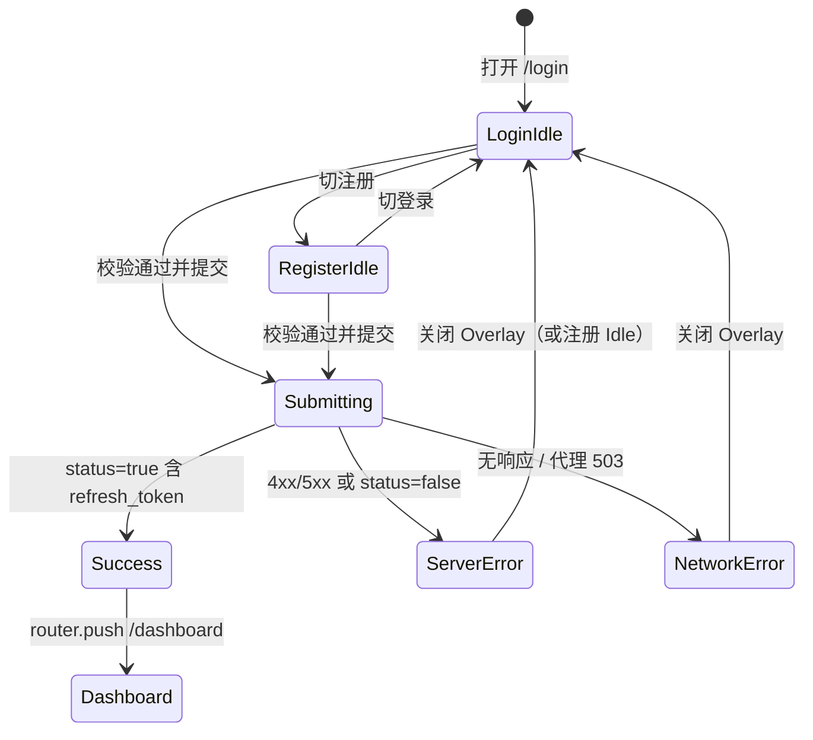
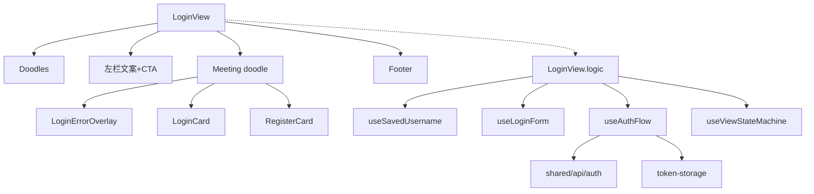

> 同目录下一页：[02-仪表盘模式页.md](./02-仪表盘模式页.md) · [html-dashboard-mode-prototype/](./html-dashboard-mode-prototype/)。

> HTML 交互原型（**Web 桌面**，浏览器窗 + Hero 双栏，非手机壳）：[html-login-prototype/index.html](./html-login-prototype/index.html)（对照板 + 跳转流程高亮 + 可点击登录/注册 Mock）。上级 `参考-UI对照板风格.png` 仅作批注/流程板式参考。

# 登录页 UI 原型需求

## 1. 文档信息

| 项 | 内容 |
| --- | --- |
| 页面名称 | 登录页（含登录 / 注册双模式） |
| 路由 | `/login`（`name: login`，组件 `frontend/src/views/LoginView.vue`） |
| 版本徽标 | `v3.0`（与左栏 Hero 一致） |
| 文档版本 | v1.0 |
| 编写日期 | 2026-10-28（Asia/Shanghai） |
| 关联模块 | 前端认证视图 `views/LoginView*`、`views/components/{LoginCard,RegisterCard,LoginErrorOverlay}`；共享 `shared/api/auth.ts`、`shared/composables/useLoginForm.ts`、`shared/auth/token-storage.ts`、`shared/api-auth-interceptors.ts`；后端 `backend/apps/accounts`（`/api/auth/*`） |
| 视觉体系 | Doodle Craft（`shared/styles/tokens.css`）+ Element Plus 2.x（表单控件）+ 登录页专用 hand-drawn Hero（`openspec/specs/frontend-login-hand-drawn-hero`） |
| 关联 OpenSpec | `frontend-login-hand-drawn-hero`、`auth-form-validation`、`auth-session`、`auth-response-shape`、`auth-registration` |

---

## 2. 目标与范围

### 2.1 做什么

- 为未登录用户提供**登录**与**注册**入口，视觉与交互对齐现有实现与 Doodle Craft 令牌。
- 成功后写入本地会话（`access_token` / `refresh_token` / `username`），跳转 `/dashboard`。
- 失败时展示可读中文错误（字段级即时校验 + 服务端错误弹层）。
- 支持「记住账号」（仅用户名，写入 `localStorage.saved_username`）。
- 路由守卫：无 token 访问其它页 → `/login`；已有 token 访问 `/login` → `/dashboard`。

### 2.2 不做什么（本页 / 本期不纳入）

- 不提供「忘记密码」「短信/邮箱验证码」「第三方 OAuth」「多账号切换卡」。
- 不改认证 API 契约、JWT 签发与吊销策略（以后端 / OpenSpec 为准）。
- 不把登录页横线本背景扩展到工作台主区。
- 不在 Meeting doodle 内再嵌套 `AppCard` / `el-card` 外壳。
- 不记住密码（仅记住账号名）。

---

## 3. 用户与场景

| 角色 | 场景 | 期望 |
| --- | --- | --- |
| 新用户 | 首次打开平台 | 看到品牌 Hero + 注册模式，完成注册后直接进入工作台 |
| 回访用户 | 曾勾选「记住账号」 | 账号预填且开关为开；输入密码后登录 |
| 回访用户 | 未记住账号 | 空白账号/密码，手动填写后登录 |
| 任意用户 | 凭证错误 / 网络失败 | 看到中文提示，可关闭后重试；登录页本地 token 不被误清（公开认证 401 不触发 refresh） |
| 已登录用户 | 误开 `/login` | 自动进 `/dashboard`，不闪登录表单后跳转即可 |
| Token 过期用户 | 工作台请求 401 且 refresh 失败 | 整页回到 `/login`（拦截器行为，本页被动承接） |

---

## 4. 信息架构与页面布局

### 4.1 分区（自上而下 / 自左而右）

1. **装饰层** `.login-page__doodles`：稀疏 SVG（swirl / ring / star），`pointer-events: none`，`aria-hidden`。
2. **Hero 双栏** `.hero`（`grid-template-columns: 1.15fr 0.85fr`，内容宽 `min(1120px, 100%)` 居中）：
   - **左栏** `.hero__intro`：标题 + 版本徽标、三行副文案、模式 CTA（登录 / 注册）。
   - **右栏** `.hero-sketch` → **Meeting doodle**：胶带装饰、模式标题、色条装饰、表单区（`LoginCard` 或 `RegisterCard`）+ 错误弹层挂载点。
3. **页脚** `.login-footer`：英文一行说明。

### 4.2 对齐与栅格

- 左栏文案块与 CTA：`max-width: 520px`，块内水平居中。
- Meeting doodle：`max-width: 420px`（≤768px 时 `360px`），轻微旋转 `1.2deg`（小屏取消旋转）。
- 表单字段：图标 18px + `el-input size=large` 横排；提交按钮通栏、`min-height: 42px`。
- 间距一律走 `--app-space-*`（见视觉规范）。

### 4.3 响应式断点（与现网 CSS 一致）

| 断点 | 行为 |
| --- | --- |
| 默认（>768px） | 双栏 Hero；标题 `--app-size-3xl`（48px）；副文案 `--app-size-2xl`（32px） |
| `max-width: 768px`（项目 sm） | 单列；标题降为 `--app-size-2xl`；副文案 `--app-size-xl`；doodle 取消倾斜 |
| `max-width: 480px` | 进一步收紧 padding；标题 `--app-size-xl`；副文案 `--app-size-lg` |
| `prefers-reduced-motion: reduce` | 关闭 doodle 入场动画与 CTA transform |

> 注：`tokens.css` 登记 sm=768 / md=1024 / lg=1200；登录页当前只实现 768 与 480。

---

## 5. 视觉规范引用

对齐 `frontend/src/shared/styles/tokens.css`（Doodle Craft）与 `LoginView.style.css` / `auth-form-card.css`。未知或设计未定处标「待设计」。

### 5.1 颜色（语义令牌）

| 用途 | 令牌 | 原子色（参考） |
| --- | --- | --- |
| 纸面底 | `--paper` | `--color-lime-94` `#fffef5` |
| 墨色文字 / 描边 | `--ink` | `--color-indigo-13` `#1e1e24` |
| 次要文字 | `--app-text-secondary` | `--color-ink-57` |
| 反白字 | `--app-text-inverse` | `--color-white` |
| 卡片底 | `--app-bg-card` | `--color-white` |
| 主 CTA / 提交按钮底 | `--app-marker-red` | `--color-red-69` |
| 字段错误 | `--app-error` | `--color-red-69` |
| 横线本纹 | `--color-blue-82-a30`（经 `--login-rule`） | — |
| doodle 胶带 | `--c-dashboard` | `--color-yellow-63` |
| doodle 阴影 / ghost active | `--c-case` | `--color-teal-49` |
| 「去注册/去登录」链接强调 | `--c-workflow` | `--color-cyan-74` |
| 装饰星点 | `--comp-paper-mark-yellow` / `--comp-paper-mark-red` / `--comp-paper-mark-brown` | — |
| Switch 开/关 | `--el-switch-on-color` ← `--app-status-success`；关 ← `--app-offline` | — |

### 5.2 字号 / 字体

| 元素 | 令牌 |
| --- | --- |
| Hero 标题 | `--app-size-3xl` + `--app-font-brand`（「Ziku FeiYang」等） |
| 副文案 | `--app-size-2xl` + `--app-font-brand` |
| Meeting 标题 | `--app-size-lg`，字重 800 |
| CTA / 提交 | `--app-size-sm`，字重 700 |
| 字段错误 / 记住账号 / 切换链 / 页脚 | `--app-size-xs` |
| 正文字体 | `--app-font`（Cascadia Mono + 中文无衬线） |

### 5.3 间距 / 描边 / 动效

| 项 | 值 |
| --- | --- |
| 间距刻度 | `--app-space-xs` 4 → `2xl` 48 |
| 登录页线型 | `.login-page` 内 `--login-line: dashed`（自有令牌，不借用侧栏） |
| 描边宽度 | `--size-stroke-sketch`（2.5px） |
| 主按钮阴影 | `3px 3px 0 0 var(--ink)`（hover 4px / active 1px） |
| 入场 | `meeting-settle`，`--app-duration-slow` + `--app-spring` |
| Element Plus primary 覆盖 | `--el-color-primary` → `--color-yellow-63`（登录提交按钮样式被 CSS 强制为 marker-red，不以 EP primary 为准） |

### 5.4 待设计

- 暗色主题下登录页纸面 / 横线对比度（当前仅 light / `:root`）。
- 超宽屏（>1440）左栏是否限宽增强（现靠 `min(1120px)`）。
- 错误弹层标题「提示」是否改为「登录失败 / 注册失败」按模式区分（可选增强，非现状）。

---

## 6. 组件清单

以现有代码为准；缺口标 **「新增建议」**。

### 6.1 页面壳 `LoginView`

| 组件/区域 | 说明 | 现状 |
| --- | --- | --- |
| 装饰 doodles | 4 个 SVG | 已有 |
| Hero 标题 / 副文案 / v3.0 | 见文案表 | 已有 |
| 模式 CTA「登录」「注册 →」 | `aria-pressed`、`data-testid=login-mode-*` | 已有 |
| Meeting doodle | 胶带 + 标题 + 色条 + body | 已有 |
| `LoginErrorOverlay` | `el-dialog` append-to-body | 已有 |
| `LoginCard` / `RegisterCard` | 按 `viewState` 互斥 | 已有 |
| 页脚 | 英文一行 | 已有 |

### 6.2 登录表单 `LoginCard`

| 字段/控件 | 类型 | placeholder / 文案 | testid | 现状 |
| --- | --- | --- | --- | --- |
| 账号 | `el-input` large + `IconUser` | 「账号」；`autocomplete=username` | `login-username` | 已有 |
| 密码 | `el-input` password + `show-password` + `IconLock` | 「密码」；`autocomplete=current-password` | `login-password` | 已有 |
| 字段错误 | `<p class="field-error">` | 见校验文案 | — | 已有 |
| 记住账号 | `el-switch` small + 文案 | 「记住账号」 | `login-remember` | 已有 |
| 提交 | `el-button` primary large | 「登录」；`loading` / `:disabled=!canSubmit` | `login-submit` | 已有 |
| 切注册 | 文本按钮 | 「没有账号？去注册 →」 | `login-to-register` | 已有 |
| 回车提交 | `<form @submit.prevent>` | — | — | 已有 |
| 忘记密码链接 | — | — | — | **新增建议**（可选，需后端能力） |
| 首焦自动聚焦账号框 | — | — | — | **新增建议** |

### 6.3 注册表单 `RegisterCard`

| 字段 | placeholder | testid | 现状 |
| --- | --- | --- | --- |
| 账号 | 「设置账号（3-20 字符）」 | `register-username` | 已有 |
| 邮箱 | 「邮箱地址」；`autocomplete=email` | `register-email` | 已有 |
| 密码 | 「设置密码（至少 6 位）」；`new-password` | `register-password` | 已有 |
| 确认密码 | 「确认密码」 | `register-password2` | 已有 |
| 提交 | 「完成注册 →」 | `register-submit` | 已有 |
| 切登录 | 「已有账号？去登录 →」 | `register-to-login` | 已有 |

### 6.4 错误弹层 `LoginErrorOverlay`

| 项 | 现状 |
| --- | --- |
| 标题 | 「提示」 |
| 正文 | 父级传入 `serverError` 原样展示 |
| 关闭 | 蒙层 / 标题栏关闭 / 「知道了」均 emit `close` |
| 宽度 | 420px；`append-to-body`（规避 doodle `transform` 含块问题） |
| testid | `login-error-message` / `login-error-dismiss` |

### 6.5 非本页但相关

| 能力 | 位置 | 说明 |
| --- | --- | --- |
| JWT 自动续期 | `api-auth-interceptors.ts` | 非公开路径 401 → refresh → 重试；失败清会话并 `location.href=/login` |
| 公开路径豁免 | `/auth/login` `/auth/register` `/auth/refresh` | 登录失败 401 **不**触发 refresh |

---

## 7. 交互说明

### 7.1 模式切换

- 默认 `viewState = "login"`。
- 点左栏「登录」/「注册 →」或表单内切换链 → `switchMode`：
  - 清空对侧表单字段（切注册清空注册四字段；切登录清空登录密码）。
  - 调用 `clearServerError`。
  - Meeting 标题同步为「登录」或「注册」。
- CTA 激活态：登录用 primary 实心；注册用 ghost；`is-active` 时 ghost 浅着色。

### 7.2 客户端校验（即时，控制 `canSubmit`）

登录（`useLoginForm`）：

| 条件 | 文案 |
| --- | --- |
| 账号空 | 请输入用户名 |
| 账号仅空白 | 用户名不能为空白 |
| 账号长度 > 150 | 用户名过长，最多150个字符 |
| 密码空 | 请输入密码 |

注册（先 `trim` 再校验，与后端 `RegisterSerializer` 对齐）：

| 条件 | 文案 |
| --- | --- |
| 用户名空 | 请输入用户名 |
| 用户名 < 3 | 用户名至少 3 个字符 |
| 用户名 > 20 | 用户名最多 20 个字符 |
| 邮箱空 | 请输入邮箱 |
| 邮箱无 `@` | 邮箱格式不正确 |
| 密码空 | 请输入密码 |
| 密码 < 6 | 密码至少 6 位 |
| 确认空 | 请再次输入密码（前端独有例外） |
| 两次不一致 | 两次密码不一致 |

- `canSubmit === false` 时提交按钮 `disabled`；若仍触发提交（防御），`ElMessage.warning` 展示首条字段错误或「请完善表单」。
- 字段错误行在输入旁即时出现；错误态输入框 `is-error`（红描边）。

### 7.3 提交与结果

1. 通过校验 → `loading=true`，清 `serverError`。
2. **登录**：`POST /api/auth/login/`，body `{ username: trim(账号), password }`（密码前端不 trim，首尾空白由后端统一去掉）。
3. **注册**：四字段前端 `trim` 后 `POST /api/auth/register/`。
4. **成功**（信封 `status===true` 且 `data` 含 `refresh_token`）：
   - `saveSession(username, access_token, refresh_token)`。
   - 登录模式且勾选记住账号 → 写 `saved_username`；未勾选 → 删除该键。
   - `ElMessage.success`：「登录成功，正在跳转...」或「注册成功，正在跳转...」。
   - `router.push("/dashboard")`。
5. **业务失败**（HTTP 错误或 `status===false`）：
   - `serverError` ← `message` 或 `getApiErrorMessage`；弹出 `LoginErrorOverlay`。
6. `finally`：`loading=false`。

### 7.4 其它交互

- 回车：表单内回车等同提交。
- 加载中：提交按钮 `loading`，避免重复点（disabled 仍由 canSubmit 控制；建议实现时 loading 期间也禁止二次提交——**现状已靠 loading 视觉 + 异步单次调用**）。
- 关闭错误弹层：`clearServerError`，表单保留已填内容。
- 路由：无 token 进其它页 → 重定向登录；有 token 进登录 → 工作台。

---

## 8. 状态矩阵

| 状态 | UI 表现 | 可操作 |
| --- | --- | --- |
| 空闲（登录） | 登录表单；若有 `saved_username` 则预填并打开开关 | 填写、切换模式、提交（字段合法时） |
| 空闲（注册） | 注册四字段空表 | 同上 |
| 填写中 | 字段错误随输入增减；非法时按钮 disabled | 继续编辑 |
| 提交中 | 按钮 loading；请求进行中 | 不宜重复提交；模式切换未强制锁死（**可选增强：loading 时禁用切换**） |
| 成功 | Toast 成功文案 → 跳转工作台 | — |
| 失败（凭证/业务） | Overlay 展示服务端文案（如「用户名或密码错误」「用户名已存在」） | 关闭后重试 |
| 网络错误 / 后端未就绪 | Overlay：`网络连接失败，请稍后重试` 或代理 503「后端服务未就绪…」经 `getApiErrorMessage` | 关闭后重试 |
| Token 过期回流 | 用户被整页带到 `/login`，表单空闲 | 重新登录 |

---

## 9. 接口约定

基路径：`/api`（axios `djangoClient`）。成功 2xx 经 `EnvelopeJSONRenderer` 包成 `{ status: true, data }`；4xx/5xx 为 `{ status: false, message[, retry] }`。

### 9.1 登录

- **路径**：`POST /api/auth/login/`
- **鉴权**：公开（`AllowAny`，无 DRF authentication）
- **请求**：`{ "username": string, "password": string }`
- **成功 200 data 示例**：

```json
{
  "access_token": "...",
  "refresh_token": "...",
  "token_type": "bearer",
  "user": { "id": 1, "username": "demo" }
}
```

- **失败展示**：
  - 401「用户名或密码错误」→ Overlay（公开路径，**不**触发 refresh）
  - 400 校验文案（如「请输入用户名」）→ Overlay / 与前端校验对齐
- 前端读取：`AuthResponse`，成功条件 `status && "refresh_token" in data`。

### 9.2 注册

- **路径**：`POST /api/auth/register/`
- **请求**：`{ username, password, password2, email }`
- **成功**：同登录令牌对 + `user` 可含 `email`；注册成功即登录。
- **失败**：400 校验；409「用户名已存在」→ Overlay。

### 9.3 续期（本页不直接调用）

- `POST /api/auth/refresh/`，body `{ refresh_token }`
- 成功 data：`{ access_token, token_type }`
- 401：清会话并跳转登录

### 9.4 登出 / 当前用户（工作台侧）

- `POST /api/auth/logout/`（需登录；吊销存储不可用 → 503 + `retry`）
- `GET /api/auth/me/` → `{ user: { id, username, is_superuser } }`（信封后为 `data.user`）

### 9.5 错误文案映射（前端 `formatApiError` / `getApiErrorMessage`）

| 条件 | 用户可见文案 |
| --- | --- |
| `response.data.message` 存在 | 原样使用（后端已中文化） |
| 401 且无 message | 登录已过期，请重新登录 |
| ≥500 | 服务暂时异常，请稍后重试 |
| 无 response | 网络连接失败，请稍后重试 |
| 其它兜底 | 服务暂时不可用，请稍后重试 |

---

## 10. 可访问性与文案

### 10.1 无障碍（现状 + 建议）

| 项 | 现状 / 要求 |
| --- | --- |
| 模式 CTA | `role="group"` + `aria-label="登录或注册"`；按钮 `aria-pressed` |
| 装饰 | `aria-hidden="true"` |
| 版本徽标 | `aria-label="当前版本 v3.0"` |
| 密码 | `show-password`；autocomplete 齐全 |
| 错误弹层 | Dialog 标题「提示」；主按钮「知道了」 |
| 字段错误 | 可见文本；**新增建议**：`aria-invalid` / `aria-describedby` 挂到 input |
| 动效 | 尊重 `prefers-reduced-motion` |

### 10.2 中文主文案（定稿，与代码一致）

| 位置 | 文案 |
| --- | --- |
| 标题 | AI 自动化测试平台 |
| 副文案 ×3 | 实现让AI来做测试 / 让测试工作摆脱重复的劳动 / 专注于创造价值 |
| 模式 CTA | 登录 / 注册 → |
| Meeting 标题 | 登录 \| 注册 |
| 登录提交 | 登录 |
| 记住账号 | 记住账号 |
| 切注册 | 没有账号？去注册 → |
| 注册提交 | 完成注册 → |
| 切登录 | 已有账号？去登录 → |
| 成功 Toast | 登录成功，正在跳转... / 注册成功，正在跳转... |
| 错误标题 | 提示 |
| 错误确认 | 知道了 |
| 页脚 | AI Automated Testing Platform · Django + Vue + Animal Island |

---

## 11. 验收标准（Checklist）

- [ ] `/login` 呈现横线本纸面 + 稀疏 doodle，装饰不拦截点击
- [ ] 左栏四行文案与 `v3.0`、双 CTA 居中；字号令牌符合 48px / 32px 档（桌面）
- [ ] 右栏 Meeting doodle 标题随模式切换；内为扁平原生表单（无嵌套 ac-card/el-card）
- [ ] 登录字段：账号、密码、记住账号、提交、去注册；testid 齐全
- [ ] 注册字段：账号、邮箱、密码、确认密码、提交、去登录；testid 齐全
- [ ] 客户端校验文案与数值阈值与 `useLoginForm` / 后端 serializer 一致（含已声明例外）
- [ ] 非法时提交按钮 disabled；合法可回车提交
- [ ] 登录成功：会话写入、可选记住账号、Toast、进 `/dashboard`
- [ ] 注册成功：同等会话写入与跳转
- [ ] 凭证错误 401：Overlay 展示「用户名或密码错误」，且不发起 refresh、不清其它无关逻辑误删本地（公开路径豁免）
- [ ] 网络/503：Overlay 可读中文
- [ ] 关闭 Overlay 后可继续编辑原表单
- [ ] 无 token 访问 `/dashboard` → 重定向 `/login`；有 token 访问 `/login` → `/dashboard`
- [ ] ≤768px 单列且取消 doodle 倾斜；`prefers-reduced-motion` 无入场动画
- [ ] 登录页虚线来自 `--login-line`，不依赖侧栏线型令牌
- [ ] 错误 Dialog `append-to-body`，遮罩盖满视口

---

## 12. 线框级结构

### 12.1 ASCII（桌面双栏）

```
┌────────────────── login-page（横线本纸面）──────────────────┐
│  (doodles: swirl / ring / stars)                            │
│  ┌──────────── hero 1.15fr ────────┐┌── 0.85fr ──────────┐ │
│  │ AI 自动化测试平台  [v3.0]         ││  ┌ meeting-doodle ┐ │ │
│  │ 实现让AI来做测试                  ││  │ ≈胶带≈          │ │ │
│  │ 让测试工作摆脱重复的劳动          ││  │ 登录 / 注册     │ │ │
│  │ 专注于创造价值                    ││  │ ──── 色条 ──── │ │ │
│  │ [ 登录 ]  [ 注册 → ]              ││  │ 👤 账号        │ │ │
│  │                                   ││  │ 🔒 密码  (👁)  │ │ │
│  │                                   ││  │ (开关) 记住账号 │ │ │
│  │                                   ││  │ [    登录    ] │ │ │
│  │                                   ││  │ 没有账号？去注册│ │ │
│  │                                   ││  └────────────────┘ │ │
│  └───────────────────────────────────┘└────────────────────┘ │
│           AI Automated Testing Platform · …                  │
└──────────────────────────────────────────────────────────────┘
```

### 12.2 状态流（Mermaid）



### 12.3 组件树



---

## 13. 实现对照索引（便于开发 / 设计走查）

| 产物 | 路径 |
| --- | --- |
| 页面 | `frontend/src/views/LoginView.vue` |
| 逻辑 | `frontend/src/views/LoginView.logic.ts` |
| 样式 | `frontend/src/views/LoginView.style.css` |
| 登录/注册卡 | `frontend/src/views/components/LoginCard.vue`、`RegisterCard.vue` |
| 错误层 | `frontend/src/views/components/LoginErrorOverlay.vue` |
| 表单样式 | `frontend/src/views/styles/auth-form-card.css` |
| 路由守卫 | `frontend/src/router.ts` |
| API | `frontend/src/shared/api/auth.ts` |
| 后端 | `backend/apps/accounts/{urls,views,serializers}.py` |
| 令牌 | `frontend/src/shared/styles/tokens.css` |

---

## 14. 可选改进（非阻塞验收）

1. **新增建议**：登录提交 loading 期间禁用模式切换，防止竞态。
2. **新增建议**：字段级 `aria-invalid` / `aria-describedby`。
3. **新增建议**：进入页自动 focus 账号框（注意与「记住账号」预填的配合）。
4. **新增建议**：Overlay 标题按模式区分「登录失败」「注册失败」。
5. 不在未立项前加入「忘记密码」；若产品需要，另开接口与原型页。

---

*本文档描述以仓库当前实现为准；标「新增建议」「待设计」项不视为现网缺陷，除非验收清单明确要求。*