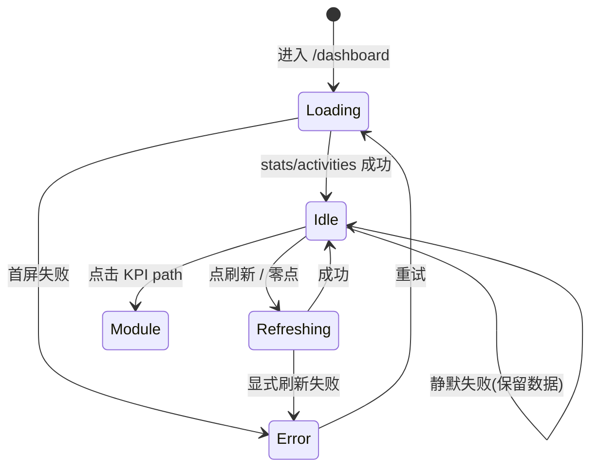
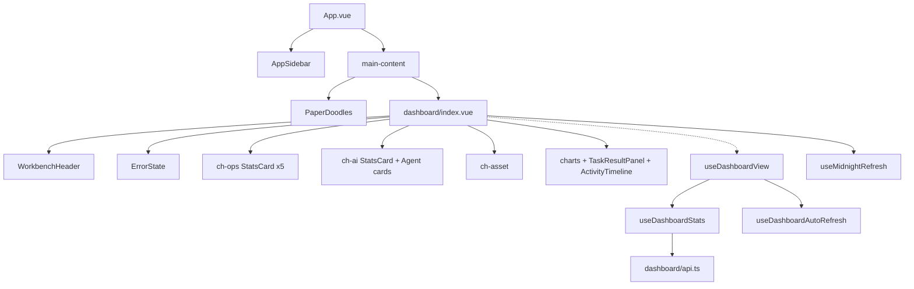

> HTML 交互原型（**Web 桌面**，浏览器窗 + 侧栏工作台，非手机壳）：[html-dashboard-mode-prototype/index.html](./html-dashboard-mode-prototype/index.html)（对照板 + 跳转流程高亮 + 可点击 KPI / 刷新 / 空态 Mock）。上级 `参考-UI对照板风格.png` 仅作批注/流程板式参考。

# 仪表盘模式页 UI 原型需求

## 1. 文档信息

| 项 | 内容 |
| --- | --- |
| 页面名称 | 仪表盘模式页（工作台总览 / Dashboard） |
| 路由 | `/dashboard`（`name: dashboard`，组件 `frontend/src/modules/dashboard/index.vue`；`meta.title` =「总览」） |
| 页头标题 | 「仪表盘」（`PAGE_HEADER.title`）；副标题见文案表 |
| 文档版本 | v1.0 |
| 编写日期 | 2026-10-29（Asia/Shanghai） |
| 选型说明 | 仓库内用户面「仪表盘」仅此一路由（侧栏主区唯一入口）。无独立「模式切换页」；「仪表盘模式页」= 登录后默认工作台总览模式页。候选排除：各模块内局部 chart 非产品壳模式。 |
| 关联模块 | 前端 `modules/dashboard/*`；共享 `shared/types/dashboard.ts`、`WorkbenchHeader`、`AppSidebar`、`KpiCard`/`StatsCard`；后端 `backend/apps/dashboard`（`/api/dashboard/*`） |
| 视觉体系 | Doodle Craft（`shared/styles/tokens.css`）+ 章节钉板（`DashboardView.style.css`）+ Element Plus 按钮 |
| 关联文档 | `dev_docs/DEV_TEST/前端功能统计-20261025.md` §3.2；`ARCH_PRD/ARCH-平台架构设计.md` dashboard 行 |

---

## 2. 目标与范围

### 2.1 做什么

- 登录成功后的**默认落地页**：平台运营 KPI、AI 用量、测试资产、趋势与动态一屏总览。
- KPI / 项目卡可点击跳转对应模块（设备、AI 助手、报告、任务、工作流、用例项目）。
- 支持手动「刷新」、可见时 30s 静默轮询、本地 00:00 跨零点刷新。
- 失败时展示 `ErrorState` + 重试；加载中 KPI 骨架；页脚展示「最近更新」与「系统状态」。
- 嵌入产品壳：左侧 `AppSidebar` + 主区纸面涂鸦（登录页不挂侧栏）。

### 2.2 不做什么（本页 / 本期不纳入）

- 不在本页编辑设备 / 创建任务 / 改智能体配置（只读总览 + 跳转）。
- 不改 `/api/dashboard/*` 契约与聚合算法（以后端为准）。
- 不把登录页横线本 Hero 带进仪表盘主区。
- 不实现「元素库」资产列（文案仍写「用例库 + 元素库」，现仅渲染用例项目 — 见已知缺口）。
- 不提供自定义仪表盘布局 / 拖拽卡片（**待设计**）。

---

## 3. 用户与场景

| 角色 | 场景 | 期望 |
| --- | --- | --- |
| 回访用户 | 登录成功 / 打开 `/` | 进入 `/dashboard`，看到四章钉板与最新 KPI |
| 运维/测试 | 查看今日运行态势 | 在线设备、运行中任务 live 脉冲、今日用量折线 |
| 成本敏感用户 | 看 AI 费用 | DeepSeek 累计/当天费用、按日费用柱、今日逐小时 |
| 空库新账号 | 尚无用例项目 | 测试资产区空态 +「前往用例管理 →」 |
| 任意用户 | 接口失败 | ErrorState 文案 + 重试；静默轮询失败不盖掉已有数据 |
| 任意用户 | 页签切后台再回来 | visibilitychange 立即静默补刷一次 |

---

## 4. 信息架构与页面布局

### 4.1 产品壳分区（桌面 Web）

1. **侧栏** `AppSidebar`：品牌「自动化测试平台」；分组导航（无标题组：仪表盘；AI 功能；数据；AI任务）；用户区 / 退出 / 折叠。
2. **主区** `.main-content`：`PaperDoodles`（相对主区视口固定）+ `.main-content__body` 滚动。
3. **页内** `.dashboard-workbench`：
   - **WorkbenchHeader**：图标渐变黄、标题「仪表盘」、副标题、右上「刷新」按钮。
   - **ErrorState**（条件）：错误文案 + 重试。
   - **doc-body** 四章钉板 + 页脚。

### 4.2 四章钉板（自上而下）

| 章节 class | 标题 | 强调色 `--ch-accent` | 内容 |
| --- | --- | --- | --- |
| `ch-ops` | 平台运营 | `--c-device` | 5 张 StatsCard：在线设备 / 活跃智能体 / 运行中任务 / 任务数量 / 工作流 |
| `ch-ai` | AI 用量 | `--c-ai` | 5 张用量 KPI + 可选智能体用量卡列表 |
| `ch-asset` | 测试资产 | `--c-case` | chip「用例 N」+ 按项目 StatsCard；空态链接 |
| `ch-trend` | 趋势与动态 | `--c-report` | 助手任务卡柱图、任务执行结果、每日 Token、每日费用、今日逐小时、Voice Token、最近动态时间线 |

### 4.3 对齐与栅格

- 钉板：纸面底 + 硬色偏移阴影 `4px 4px 0 0 var(--ch-accent)`；轻微旋转（ops -0.25° / ai 0.35° / asset -0.2° / trend 0.15°）。
- KPI 网格：`.dashboard__stats-grid`（多列自适应；窄屏收拢）。
- 趋势区：双列 `.dashboard__trends`，单列修饰 `--single` / `--ai`。
- 间距走 `--app-space-*`；主区水平 padding `--app-space-lg`。

### 4.4 响应式

| 断点 | 行为 |
| --- | --- |
| 桌面（默认） | 侧栏展开 + 多列 KPI + 双列趋势 |
| `~1100px` | AI 用量智能体列表与 KPI 纵向堆叠（现网 scoped 规则） |
| 侧栏折叠 | 图标轨；主区变宽（壳层行为，非本页独占） |
| `prefers-reduced-motion` | 减弱 live 脉冲 / count-up（**新增建议**：明确挂到 StatsCard） |

> 交付形态为**桌面 Web**；窄屏仅为适应性说明，不做手机壳。

---

## 5. 视觉规范引用

对齐 `tokens.css`、`DashboardView.style.css`、`WorkbenchHeader`、侧栏 `MOD_COLORS["/dashboard"]=--c-dashboard`。

### 5.1 颜色

| 用途 | 令牌 | 参考值 |
| --- | --- | --- |
| 纸面底 | `--paper` | `#fffef5` |
| 墨色 | `--ink` | `#1e1e24` |
| 仪表盘模块 / Header 渐变终点 | `--c-dashboard` | `#f7c948` |
| 平台运营钉板 | `--c-device` | 绿系 |
| AI 钉板 | `--c-ai` | 紫系 |
| 资产钉板 / Token 系列 | `--c-case` | `#4ECDC4` 近 teal |
| 趋势钉板 / 费用系列 | `--c-report` / `#F7C948` | — |
| 刷新按钮 | `.wb-btn--sunset` | 日落暖色（现网） |
| marker 高亮条 | `--c-dashboard` 半透明 | chapter-title `.marker` |

### 5.2 字号 / 字体

| 元素 | 令牌 |
| --- | --- |
| 页头标题 | WorkbenchHeader（约 `--app-size-xl` 档） |
| 章节标题 | `--app-size-md` + display 字重 800 |
| eyebrow | `--app-size-xs` 大写字距 |
| KPI 数字 | 计数动画；百万单位后缀 `M` |
| 页脚 | `--app-size-xs` 级 |

### 5.3 待设计

- 暗色主题下钉板阴影对比。
- 「元素库」第二资产列是否恢复（文案已写、UI 未做）。
- 自定义卡片显隐 / 布局（非现状）。
- Voice 空态与图表空态插画统一。

---

## 6. 组件清单

以现有代码为准；缺口标 **「新增建议」**。

### 6.1 页面壳与页头

| 组件/区域 | 说明 | 现状 |
| --- | --- | --- |
| `AppSidebar` | 壳层；仪表盘高亮 | 已有 |
| `PaperDoodles` | 主区装饰 | 已有 |
| `WorkbenchHeader` | 标题/副标题/图标/actions | 已有 |
| 刷新 `el-button` | `:loading=refreshing` | 已有 |
| `ErrorState` | 错误 + `@retry=loadData` | 已有 |

### 6.2 平台运营 `StatsAppCard` ×5

| 标签 | path | color | 特殊 | 现状 |
| --- | --- | --- | --- | --- |
| 在线设备 | `/devices` | sage | — | 已有 |
| 活跃智能体 | `/ai-assistant` | gray | — | 已有 |
| 运行中任务 | `/reports` | rose | `live` 当 active>0 | 已有 |
| 任务数量 | `/tasks` | gray | desc「今日 N」 | 已有 |
| 工作流 | `/workflow` | pale | — | 已有 |

### 6.3 AI 用量

| 项 | 说明 | 现状 |
| --- | --- | --- |
| 累计/当天用量 | `toMillions` + 后缀 `M`，desc DeepSeek | 已有 |
| 缓存命中率 | `%`，1 位小数 | 已有 |
| 总费用 / 当天费用 | 元，significantDigits=3 | 已有 |
| 智能体卡 | 缓存命中/输入/输出/总费用 | 已有（有 agents 时） |

### 6.4 测试资产

| 项 | 现状 |
| --- | --- |
| chip 用例总数 | 已有 |
| 项目 StatsCard → `/cases/projects/:id` | 已有 |
| 空态 + RouterLink `/cases` | 已有 |
| 元素库列 | **新增建议**（或删文案「+ 元素库」） |

### 6.5 趋势与动态

| 组件 | 说明 | 现状 |
| --- | --- | --- |
| `TrendBarChart` | 助手任务卡成功/失败 | 已有 |
| `TaskResultPanel` | 最近任务 + summary | 已有 |
| `SeriesBarChart` | Token / 费用 / Voice | 已有 |
| `TodayUsageChart` | 今日双轴逐小时 | 已有 |
| `ActivityTimeline` | 最近动态 | 已有 |

### 6.6 逻辑 composable

| 名称 | 职责 | 现状 |
| --- | --- | --- |
| `useDashboardView` | 编排 + 系列色 | 已有 |
| `useDashboardStats` | 拉取/映射/刷新 | 已有 |
| `useDashboardAutoRefresh` | 30s 静默 + visibility | 已有 |
| `useMidnightRefresh` | 本地零点刷新 | 已有 |

---

## 7. 交互说明

### 7.1 进入与鉴权

- `/` → redirect `/dashboard`。
- 无 token → 守卫送 `/login`；有 token 访问 `/login` → `/dashboard`。
- `onMounted` → `loadData()`（stats + activities 并行 `Promise.allSettled`）。

### 7.2 刷新

1. 点「刷新」→ `refreshData()`（`refreshing` loading，不清已有数据至失败）。
2. 每 30s `refreshSilently()`（页隐藏跳过；回前台立即一次）。
3. 本地 00:00 → `refreshData()`（跨零点换「今日」系列）。

### 7.3 KPI 跳转

- StatsCard 有 `path` 时点击 `router.push(path)`。
- 运行中任务 live 脉冲不拦截点击。

### 7.4 错误与空态

- stats 失败：`error` 文案「统计数据加载失败…」或服务端 `message`；整页 ErrorState。
- activities 单独失败：仅当尚无 error 时写活动失败文案。
- 静默轮询失败：保留上次成功数据，不盖 ErrorState。
- 无用例项目且非 loading：空态文案 + 链接。
- 无 Voice 分类：`暂无 Voice 用量`。

### 7.5 图表与数值

- Token 展示：百万 `M`，两位小数（`toMillions`）。
- 费用：有效数字 3 位 +「元」。
- ECharts 系列色字面量（Canvas 不解析 CSS 变量）：Token `#4ECDC4`、缓存 `#A78BFA`、费用 `#F7C948`。

---

## 8. 状态矩阵

| 状态 | UI 表现 | 可操作 |
| --- | --- | --- |
| 首屏加载 | KPI skeleton / loading | 等待；侧栏可导航 |
| 空闲·有数据 | 四章钉板 + 页脚时间/状态 | 刷新、点 KPI、滚动态 |
| 空闲·无用例 | 资产空态 | 前往用例管理 |
| 刷新中 | 按钮 loading | 防重复点（loading） |
| 静默刷新 | 无全页打断 | 正常浏览 |
| 错误 | ErrorState | 重试 loadData |
| 运行中任务>0 | 对应卡 live | 仍可点进报告 |
| 系统无设备 | 页脚「无设备连接」 | — |
| 系统正常 | 页脚「正常运行」 | — |

---

## 9. 接口约定

基路径：`/api`。信封 `{ status, data[, message] }`。

### 9.1 统计总览

- **路径**：`GET /api/dashboard/stats/`
- **鉴权**：需登录
- **前端**：`fetchDashboardStats()` → `mapStatsResponse`
- **data 主要字段**（见 `DashboardRawData`）：
  - `devices` / `cases` / `runs` / `agents` / `workflow`
  - `ai_usage`（含 `task_count`、`total_tokens`、`cache_hit_rate`、`deepseek_cost`、`agents`…）
  - `charts.execution` / `ai_tokens` / `deepseek_cost` / `today_usage`
  - `execution_summary` / `recent_tasks` / `last_updated` / `system_status`
  - `usage_ledger`（含 `voice_today` / `voice_total`；旧版可缺省）

### 9.2 活动时间线

- **路径**：`GET /api/dashboard/activities/`
- **查询**：`limit` / `offset`（页面默认首屏）
- **data**：`ActivityItem[]`（`type` / `action` / `time` / `detail?` / `tags?`）

### 9.3 错误文案（本页）

| 条件 | 文案 |
| --- | --- |
| stats 无 status/data | `message` 或「统计数据加载失败，请检查网络连接」 |
| activities 失败且尚无 error | 「活动记录加载失败，请检查网络连接」 |
| 其它 catch（非 silent） | 「仪表盘数据加载失败，请稍后重试」 |

---

## 10. 可访问性与文案

### 10.1 无障碍

| 项 | 现状 / 要求 |
| --- | --- |
| 侧栏当前项 | active 样式；折叠时 `title` 提示 |
| 刷新按钮 | loading 态可读 |
| 装饰涂鸦 | 不应拦截点击（壳层） |
| 图表 | **新增建议**：为关键图提供文字摘要 / aria |
| 动效 | **新增建议**：尊重 `prefers-reduced-motion` |

### 10.2 中文主文案（定稿，与代码一致）

| 位置 | 文案 |
| --- | --- |
| 侧栏 | 仪表盘 |
| 页头标题 | 仪表盘 |
| 页头副标题 | 自动化测试平台 · 实时监控设备状态、用例执行、AI Agent 与测试报告 |
| 刷新 | 刷新 |
| 章标题 | 平台运营 / AI 用量 / 测试资产 / 趋势与动态 |
| 章 eyebrow | Platform Ops / AI Usage / Test Assets / Trends & Activity |
| 资产空态 | 暂无用例项目 / 前往用例管理 → |
| Voice 空 | 暂无 Voice 用量 |
| 页脚 | 最近更新: … / 系统状态: 正常运行 \| 无设备连接 |
| document.title | `总览 — Android-AutoTests` |

---

## 11. 验收标准（Checklist）

- [ ] `/dashboard` 在侧栏壳内呈现四章钉板（运营 / AI / 资产 / 趋势），纸面底 + 模块色硬阴影
- [ ] WorkbenchHeader 标题「仪表盘」+ 副标题 + 刷新按钮
- [ ] 5 张运营 KPI 可点击跳转正确 path；运行中>0 有 live
- [ ] AI 用量 5 KPI 单位（M / % / 元）正确；有 agents 时展示列表
- [ ] 测试资产 chip 总数 + 项目卡跳 `/cases/projects/:id`；无项目空态链接 `/cases`
- [ ] 趋势区含任务卡柱图、结果面板、Token/费用柱、今日双轴、Voice、活动时间线
- [ ] 首屏 `GET /api/dashboard/stats/` + `activities/`；失败 ErrorState 可重试
- [ ] 手动刷新 loading；30s 静默；隐藏暂停、回前台补刷；零点刷新
- [ ] 页脚最近更新与系统状态文案正确
- [ ] 无 token 无法停留本页；`/` 进入本页
- [ ] 桌面 Web 布局（侧栏+主区），非手机壳
- [ ] 文案「元素库」与真实 UI 不一致处已在文档标注缺口

---

## 12. 线框级结构

### 12.1 ASCII（桌面工作台）

```
┌─ AppSidebar ─┬──────── main-content（纸面 + PaperDoodles）────────┐
│ 品牌          │ WorkbenchHeader [图标] 仪表盘          [ 刷新 ]   │
│ ● 仪表盘      │──────────────────────────────────────────────────│
│ AI 功能…      │ ┌ ch-ops 平台运营 ─────────────────────────────┐ │
│ 数据…         │ │ [在线设备][智能体][运行中*][任务数][工作流]   │ │
│ AI任务…       │ └──────────────────────────────────────────────┘ │
│               │ ┌ ch-ai AI 用量 ───────────────────────────────┐ │
│ (用户/退出)   │ │ [累计M][当天M][命中%][总费用][当天费用]      │ │
│               │ │ (智能体卡…)                                  │ │
│               │ └──────────────────────────────────────────────┘ │
│               │ ┌ ch-asset 测试资产  [用例 N] ─────────────────┐ │
│               │ │ 项目卡… 或 空态→用例管理                     │ │
│               │ └──────────────────────────────────────────────┘ │
│               │ ┌ ch-trend 趋势与动态 ─────────────────────────┐ │
│               │ │ 柱图|结果 │ Token|费用 │ 今日 │ Voice │ 动态 │ │
│               │ └──────────────────────────────────────────────┘ │
│               │ 最近更新 … · 系统状态 …                          │
└───────────────┴──────────────────────────────────────────────────┘
```

### 12.2 状态流（Mermaid）



### 12.3 组件树



---

## 13. 实现对照索引

| 产物 | 路径 |
| --- | --- |
| 页面 | `frontend/src/modules/dashboard/index.vue` |
| 逻辑 | `DashboardView.logic.ts` |
| 样式 | `DashboardView.style.css` |
| 路由 | `modules/dashboard/routes.ts`（汇总于 `router.ts`） |
| API | `modules/dashboard/api.ts` |
| 类型 | `shared/types/dashboard.ts` |
| 侧栏配置 | `shared/components/sidebarNavConfig.ts` |
| 壳 | `App.vue` + `AppSidebar.vue` |
| 功能统计 | `dev_docs/DEV_TEST/前端功能统计-20261025.md` §3.2 DASH-01…07 |

---

## 14. 可选改进（非阻塞验收）

1. **新增建议**：补齐或删除「元素库」文案与列，消除误导（功能统计 G 已知问题）。
2. **新增建议**：图表区文字摘要 / `aria-label`。
3. **新增建议**：`prefers-reduced-motion` 关闭 live 与 count-up。
4. **新增建议**：刷新失败 Toast（现仅 ErrorState 在显式 load/refresh 路径）。
5. **待设计**：用户自定义钉板显隐与顺序。

---

*本文档描述以仓库当前实现为准；标「新增建议」「待设计」项不视为现网缺陷，除非验收清单明确要求。选型：「仪表盘模式页」= `/dashboard` 工作台总览。*
