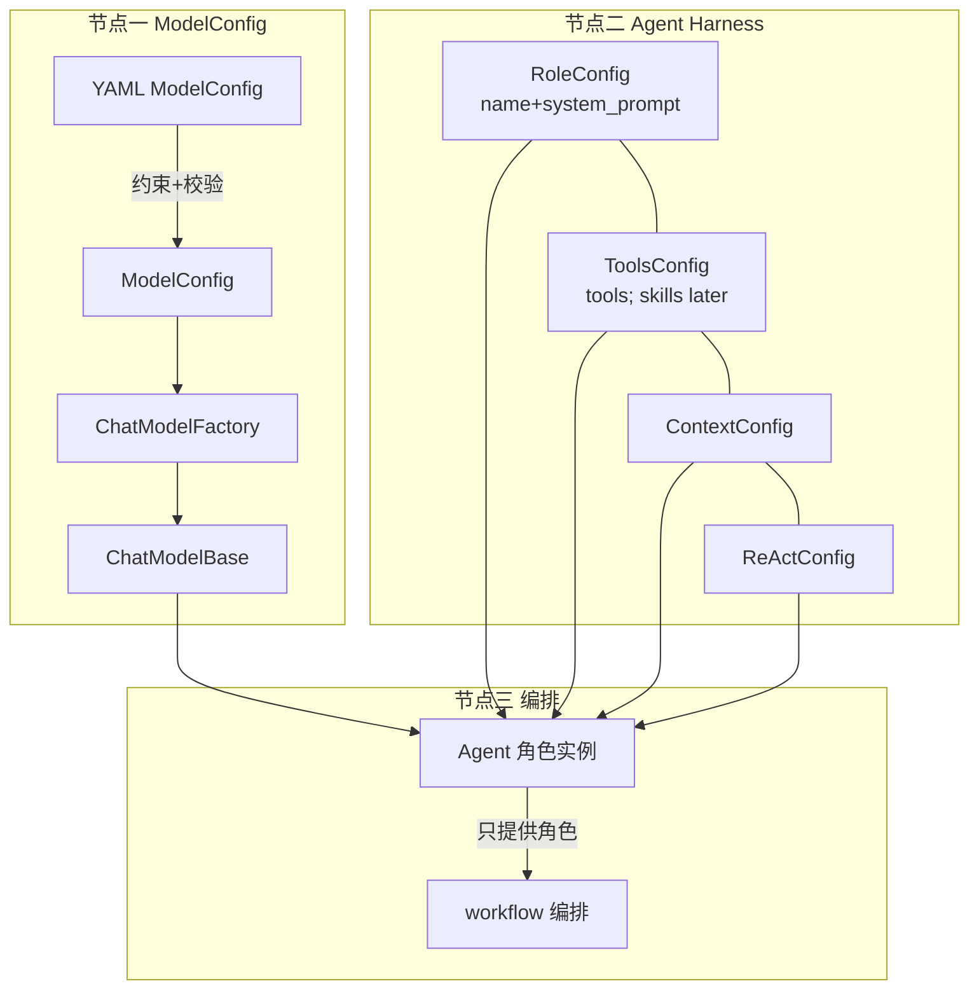
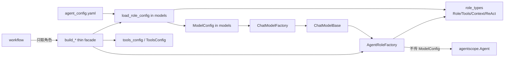

## Context

See proposal.md - Why。本地 WIP 已形成「YAML 五段 + AgentRoleFactory + build_*」骨架（详见 `temps/agent_create_flow_complexity.md`），与 `temps/agents_architecture.md` 分层总图一致。当前最大结构债是 **config.models ↔ agent_builders 循环依赖**（装载器运行时 import 四分段类型；工厂 create / build_* 又 import ModelConfig / load_role_config），其次是 `models.py` 过重与 UI/case middleware 策略散落。

Realtime 路径（`realtime_vocie_agent` → Omni `RealtimeAgent`）独立于 Factory，本设计仅标注边界，不纳入改造。

**skills**：目标形态可归属 `ToolsConfig`，但 **本期明确延后**，不扩展字段、不改 YAML 产品语义。

## 目标颗粒度（三节点，锁定）

用户定义的目标形态；后续实现与 spec 以此为准，**本期先写入设计锁定，不在本文件等同于已落地代码**。

### 节点一（N1）：ModelConfig → 模型对象 → Agent

- **目的**：约束并校验 YAML 中的 `ModelConfig` 字段（格式 OK 后再创建模型）。
- **产物**：创建完成后得到聊天模型对象（`ChatModelBase` / 等价），**只把模型对象交给 Agent**。
- **防火墙**：`Agent`（含其对外可见构造/运行面）**MUST NOT** 接触 `ModelConfig`；装载与 `ChatModelFactory` 负责配置→模型的转换，Agent 只看见已创建的 model。

### 节点二（N2）：Agent Harness 子节点 1:1、互不干涉

Agent 装配侧有多个子节点，配置与对应运行数据一对一管理，链路不交叉、不碰撞：

| 子节点 | 只负责（本期） | MUST NOT 掺入 |
| --- | --- | --- |
| `RoleConfig` | 名称 + 系统提示词（`name` + `system_prompt`） | 工具 / skills / 上下文压缩 / ReAct 轮次 / 模型连接 |
| `ToolsConfig` | 工具（toolkit 占位 / 经 `tools_config` 注入） | 角色名提示词 / Context / ReAct / ModelConfig / **skills（延后）** |
| `ContextConfig` | 上下文相关配置 | 工具 / 角色 / ReAct / 模型 |
| `ReActConfig` | ReAct 相关配置 | 工具 / 角色 / Context / 模型 |

- **暴露面**：上述子节点配置留在 **Agent 配置/装载层** 内部，**不作为对外公共 API**（对外以 `build_*` → `Agent` 实例为主）；禁止把某一段配置泄漏进另一段的数据结构或另一条 Agent 链路。
- **实例隔离**：每个 `build_*` / 每次 create 得到独立 Agent；不同角色链路的 toolkit / prompt / 配置 MUST NOT 共享可变状态。
- **skills**：OUT OF SCOPE 本期；后续单独变更再扩展 `ToolsConfig` / 产品语义。

### 节点三（N3）：Agent 与 workflow

- **Agent**：只提供角色（已装配好的角色实例：名字、提示词、模型、工具、context/react 等已内化）。
- **workflow**：负责编排（SOP / GoalPipeline / 步骤流转、事件、交接）；MUST NOT 把 ModelConfig 或四分段配置当作编排 API 的一部分对外穿梭；编排侧消费的是 Agent（角色），而不是重新解析 YAML 五段。
- **旁路清理延后**：`workflow` → `tool_*` / create 后改 toolkit 等 **本期不改代码**（已在 Non-goals）。



## Goals / Non-Goals

**Goals:**

- **锁定**上述三节点颗粒度为基本角色创建的目标架构（设计/spec 对齐；实现按 tasks 分步）。
- 明确「基本 LLM 角色」create 的单一调用链与模块所有权。
- 拆掉 `config.models` ↔ `agent_builders` 类型环；四分段配置类型有稳定归属，且与 ModelConfig 管线分离。
- N1 防火墙：Agent 只见 `ChatModelBase`。
- 保持对外 `build_*` / 旧名别名语义；落地后行为与现网 WIP 对齐（回归绿）。

**Non-Goals:**

- **skills**（ToolsConfig 扩展 skills、skills 产品链路）— **延后单独处理**。
- 不在本期完整落地「配置不对外暴露」的全部 API 收缩（可保留过渡期 re-export）；但设计上已判定为非公共面。
- 不统一 UI/case 的 middleware 默认策略（不强制 case 也装默认中间件）。
- 不重命名 `realtime_vocie*`、不把 Omni 并进 `AgentRoleFactory`。
- **不在本期清理** `workflow` → `tool_*` / `tools_config` 旁路与 create 后改 toolkit（属 N3 债务，后续单列）。
- 不改工具实现与 YAML 中空 ToolsConfig 的产品语义（空节 = 占位；实际工具仍经 `tools_config` 注入）。
- 不拆分 ChatModelFactory / Realtime / Ready 目录的完整搬家。

## Decisions

### 当前流程（As-Is）与相对目标的缺口

```mermaid
flowchart LR
  YAML[agent_config.yaml] --> LC[load_role_config]
  LC --> T1[Role/Tools/Context/ReAct<br/>定义在 agent_builders]
  LC --> MC[ModelConfig<br/>定义在 models]
  T1 -.->|runtime import| LC
  Build[build_*] --> LC
  Build --> TK[tools_config]
  Build --> F[AgentRoleFactory]
  F -->|仍持有 ModelConfig| CF[ChatModelFactory]
  CF --> CMB[ChatModelBase]
  F --> MW[_default_middlewares<br/>或 middlewares=[]]
  F -->|model=CMB| AS[agentscope.Agent]
  Build -.->|import| MC
  WF[workflow] --> Build
  WF -.->|旁路| tool[tool_* / tools_config]
```

**对照三节点的简要缺口（WIP 快照）：**

1. **N1**：`AgentRoleFactory.create` 已用 `ChatModelFactory` 得到 model 再 `Agent(..., model=model, ...)`，**Agent 构造面未接收 ModelConfig**（符合方向）。但 Factory `__init__` / 实例属性仍持有并贯穿 `ModelConfig`；`load_role_config` / `ui_*_role_config` 五元组把 `ModelConfig` 与四分段一起暴露给装配层——目标是配置止于「建模型」，Agent 侧只见 `ChatModelBase`。
2. **N2**：四分段 dataclass 字段边界大体对，但类型住在 `agent_builders` 且被 `models` 运行时 import（环）；`ToolsConfig` 现仅为 toolkit 占位；**skills 延后，本期不扩展**；类型与 `*_role_config()` 五元组仍偏「半公共」。
3. **N3**：workflow 已主要 `import build_*` 拿角色再编排（符合「Agent 提供角色」）；同时存在对 `tool_*` / `tools_config` 的旁路，以及 create 之后再 `toolkit.add_tool`——**本期 Non-goal，记为目标债**。

### 目标流程（To-Be）

在方案 B（类型拆环）之上，按三节点收束：



单向依赖：`role_types` ← `models` / `agent_builders`；`agent_builders` → `models`（装载与 ChatModelFactory）允许，**禁止** `models` → `agent_builders`。  
N1：**禁止**把 `ModelConfig` 传入 `Agent(...)`；Factory 内部可短暂持有配置仅用于 `ChatModelFactory.create()`。  
N2：四分段 1:1，不交叉字段；默认不对外导出为稳定公共 API；**skills 不在本期**。  
N3：workflow 编排入口只依赖 `build_*` → Agent；工具旁路收敛不在本期强制改代码。

### 方案对比

| 方案 | 做法 | 优点 | 缺点 |
| --- | --- | --- | --- |
| **A 保持** | 仅文档化，靠 lazy import 维持 | 零代码风险 | 环与样板债继续放大；三节点边界不稳 |
| **B 抽取类型拆环（推荐）** | 四分段 dataclass 迁到独立模块；设计锁定 Model 与 Harness、Agent 与 workflow 边界 | 边界清晰；装载/工厂可测可独立 import；符合 harness「配置与装配分离」 | 需改 import；短窗口破坏性限于内部符号 |
| **C 仅瘦 build_* 门面** | 用注册表/三元组生成 build_* | 减少样板 | **不解决环**；也不锁定 ModelConfig/Agent 防火墙 |

**推荐：B 为主，C 为辅**——先拆类型环并写清三节点；`build_*` 保持显式函数，内部继续 `_agent_from_role_bundle`；若样板仍痛，再用轻量 helper，不引入注册表框架。

### Middleware 策略（本期冻结）

- UI：`middlewares=None` → `_default_middlewares` → `build_agent_middlewares`。
- case*：继续显式 `middlewares=[]`。
- 后续 SPEC 再考虑角色级 middleware profile；本期不改行为。

### Migration

1. 新增 `role_types`（名称以实现时 AGENTS.md 为准），迁入四个 dataclass + 可选 `_as_*`。
2. `agent_builders` / `models` 改为从 `role_types` 导入；删除 models→builders 的运行时 import。
3. 保留 `agent_builders` 对 `RoleConfig` 等的再导出（过渡期）；文档标明非长期公共 API。
4. 确保 `AgentRoleFactory.create` 只把 `ChatModelBase` 交给 `Agent`；避免新代码把 `ModelConfig` 传入 Agent 构造。
5. 跑装配相关 pytest + `ruff check`；可选 AST/导入测试断言 `config.models` 模块图中不出现 `agent_builders`。
6. **不做**：skills 字段、workflow `tool_*` 清理。

## 模块防火墙自检

- 变更仅在 `engines/agents/**`；不新增对 `django` / `apps.*` / `backend.apps.*` 的 import。
- 无跨 App 写库；无前端变更。
- 密钥仍经环境变量名在 YAML 中引用，由 `models._get_api_key` 解析。
- ModelConfig 不进入 Agent 构造参数；Harness 四分段互不写对方字段；workflow 不以五段配置为编排 API。
- skills 不在本期 diff。

## Risks / Trade-offs

- [再导出兼容期拉长] → 显式 re-export；后续 SPEC 可删。
- [搬家漏改 import] → 保留 re-export + pytest 兜底。
- [范围蠕变到 skills / middleware / realtime / workflow 旁路] → Non-goals + tasks 禁止对应实现项。
- [models.py 仍然偏大] → 接受；完整拆分后续。
- [ToolsConfig 尚无 skills] → **有意延后**，非遗漏。
